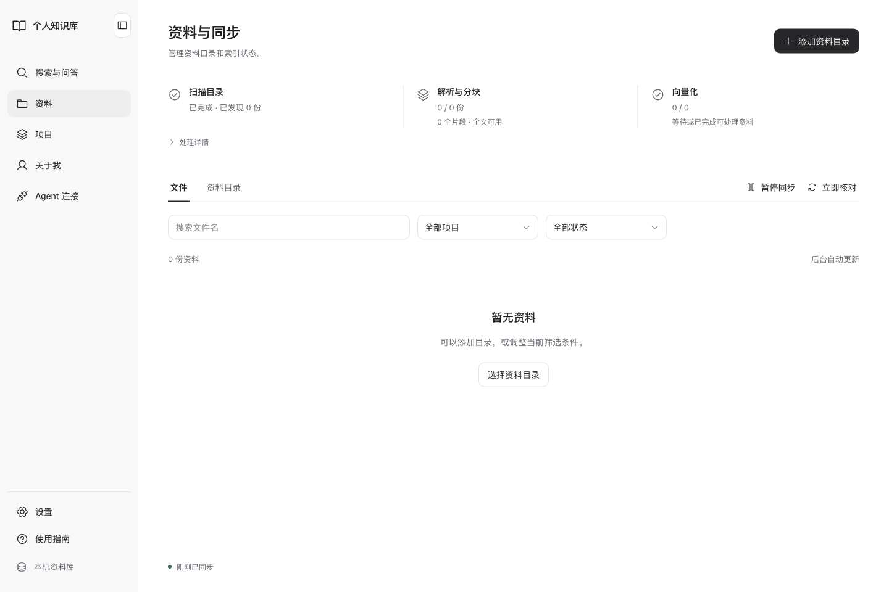
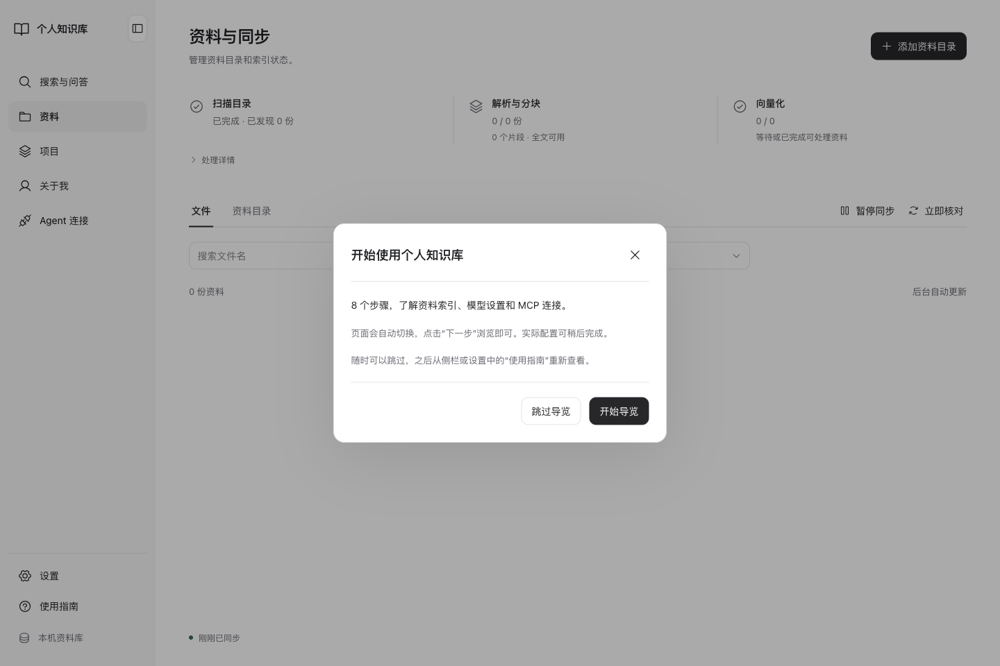
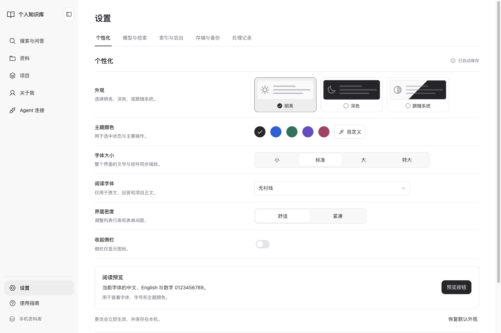
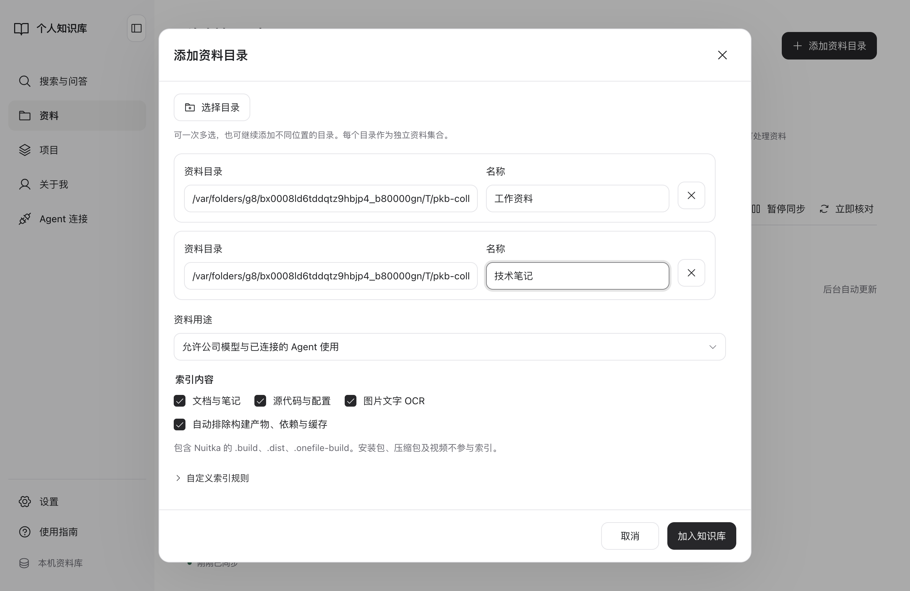

# Personal Knowledge · 个人知识库

[English](README.md) · [简体中文](README.zh-CN.md)

[](https://github.com/JshengZ/personal-ai-knowledge-base/actions/workflows/ci.yml)
[](https://github.com/JshengZ/personal-ai-knowledge-base/releases)
[](LICENSE)

A local-first desktop knowledge base that gives MCP agents access to your projects, documents, and confirmed memories. Choose folders once; new and changed files are indexed automatically. Use ZCode or another MCP client as your everyday interface, with a complete desktop workspace for searching, reviewing sources, and managing access.

**Install the desktop app. No terminal, Docker, Python, or separate model setup is required for normal use.** The current desktop interface is in Simplified Chinese; documentation is available in English and Chinese.



Light, dark and system appearance, custom accents, font sizes and density. [Appearance settings](docs/images/appearance.png) preview immediately and save locally.

**1.1.0:** isolated query/FTS lanes, quiet-time incremental indexing, complete file-list pagination, headless MCP recovery, Windows proxy controls and a live runtime status panel. [Release details](docs/releases/v1.1.0.md).

## Download

| Platform         | v1.1.0 installer                                                                                                                          | Status                                                    |
| ---------------- | ----------------------------------------------------------------------------------------------------------------------------------------- | --------------------------------------------------------- |
| macOS, Intel x64 | [Download DMG](https://github.com/JshengZ/personal-ai-knowledge-base/releases/download/v1.1.0/Personal-Knowledge-1.1.0-mac-x64.dmg)       | Packaged application tested on macOS 14.6.1               |
| Windows, x64     | [Download installer](https://github.com/JshengZ/personal-ai-knowledge-base/releases/download/v1.1.0/Personal-Knowledge-1.1.0-win-x64.exe) | Native CI and target-environment status: see verification |

[All releases](https://github.com/JshengZ/personal-ai-knowledge-base/releases) · [Checksums](https://github.com/JshengZ/personal-ai-knowledge-base/releases/download/v1.1.0/SHA256SUMS.txt) · [Release notes](CHANGELOG.md)

Installers bundle the embedding model and English/Chinese OCR data, so downloads are approximately 800 MiB. Native Apple Silicon and ARM Windows installers are not included in v1.1.0. These installers are **unsigned**; macOS may require an explicit open authorization and Windows may display an unknown-publisher prompt. See the [installation guide](docs/user-guide.md).

## Get started

First launch offers an optional, replayable guide on the real interface. New installations contain no sample projects or documents.

1. On macOS, open the DMG and drag **个人知识库** into Applications. On Windows, use the installer wizard to choose the program folder and install for the current user.
2. On first launch, choose the knowledge data location (separate from the program folder), then view or skip the optional guide. Add a project or document folder from Sources.
3. For answers and project summaries inside the app, enter your organization's model API URL, model name, and credentials in Settings. This is optional when your MCP agent already has its own chat model.
4. Open **Agent 连接**, explicitly choose automatic sharing or specific projects, and select **一键配置 ZCode**. Existing ZCode settings are preserved and backed up. Other clients can use generated JSON, Codex TOML, or local Streamable HTTP settings.
5. Start a new agent conversation and ask a project question. Check that it calls the knowledge tools and cites the original sources.

Files inside selected folders stay up to date after edits, renames, and deletions. Closing the window keeps indexing in the tray. Use the tray or app menu to quit. Each colleague installs their own independent knowledge base and chooses their own folders and credentials.

## Interface and built-in guide

New libraries are empty. The optional guide walks through eight real screens, with Next, Previous, Skip and Escape; replay it from the sidebar or Settings. Unsaved form drafts and the previous view are retained.





[Guide on the MCP page](docs/images/onboarding-mcp.png) · [Storage and capacity](docs/images/storage.png) · [Themed dropdown](docs/images/controls.png) · [Connection permissions](docs/images/actions.png)

Screenshots show the actual Electron interface in an isolated empty library. Path labels are generalized; no personal data or credentials are included.

## Features

- **Storage and load controls:** Windows installation folder selection, data-location setup and verified migration, disk reserve and index-size limits, CPU profiles, and separate file/chunk/vector progress.
- **Responsive MCP:** initialization and tool discovery do not wait for indexing; slow queries have bounded waits and full-text fallback.

- **MCP as the primary interface:** stdio and Streamable HTTP; scoped project access, confirmed memories, and optional memory proposals.
- **Named collections:** select multiple folders in one native dialog, name each independently, and filter a whole collection or an individual detected project.
- **Automatic indexing:** filesystem notifications, persistent work queues, retries, reconciliation and explainable exclusions, including Nuitka outputs and already indexed noise.
- **Automatic agent scope:** choose the scope when creating a connection; automatic sharing includes future additions only after you select it. Existing authorizations are preserved. Collection deletion immediately revokes retrieval and preserves project notes in the archive.
- **Hybrid RAG:** Chinese-aware full-text search, vector retrieval, reciprocal rank fusion, and optional API reranking.
- **Traceable sources:** PDF pages, code lines, DOCX paragraphs, slides, spreadsheet cells, and document versions.
- **Project workspace:** editable goals, approaches, decisions, and API-generated summaries with evidence.
- **Reviewable memory:** model and agent suggestions wait for confirmation; changed evidence marks memories for review.
- **Local administration:** folder permissions, client settings, keychain credentials, backup/restore, background operation, and startup preferences.

Supported inputs include PDF, DOCX, PPTX, XLSX, CSV/TSV, Markdown, text, common code files, Jupyter notebooks, images, and scanned PDFs. OCR runs locally for images and scanned PDFs. Embedded Office images/charts are not comprehensively extracted; legacy Office formats require conversion. Excel reads cached formula results; notebook execution outputs are excluded. Legacy Office formats and encrypted documents need conversion or decryption first.

## Collections and indexing rules

Choose multiple folders with **添加资料目录 → 选择目录**. Each folder keeps its chosen collection name, while code projects inside it remain independently selectable. Automatic rules skip known dependencies/build/cache folders, Nuitka `.build`/`.dist`/`.onefile-build` folders and recognizable generated bundles. Archives, installers, videos and binary content are not indexed; Office documents use dedicated parsers.

Inspect skip reasons in Sources. Use content categories, explicit relative paths, or glob rules to refine the scope; **额外纳入的路径** can override automatic rules. Explicit exclusions win. Unknown generated folders cannot be classified with certainty, so review the scope before indexing a large disk folder. [Full rule precedence and upgrading](docs/user-guide.md#collections-and-exclusions).



## Models and data flow

| Stage                      | Implementation                                                                                               |
| -------------------------- | ------------------------------------------------------------------------------------------------------------ |
| Parsing / OCR              | Local Node worker, PDF.js, Office parsers, Tesseract.js                                                      |
| Full-text retrieval        | SQLite FTS5 with Jieba segmentation                                                                          |
| Embeddings                 | Configured organization API, or bundled **Qwen3-Embedding-0.6B Q8_0** via llama.cpp; 1024 dimensions locally |
| Retrieval / reranking      | Scoped candidates, RRF fusion, optional organization reranking API                                           |
| In-app answers / summaries | Your configured OpenAI-compatible or Anthropic Messages API                                                  |
| Agent answers              | The model already configured in your MCP client                                                              |

No local chat LLM is required. The bundled embedding model is approximately 610 MiB and runs on CPU. If a configured API fails, the app reports the failure and preserves full-text retrieval; it does not silently send documents to another provider.

This is retrieval and evidence-backed memory, not model training. An agent's use of MCP depends on its tool-calling behavior. The connection screen includes suggested client instructions.

## Privacy and permissions

Only explicitly selected folders are indexed. Each folder can be restricted to local retrieval, permitted organization-model use, or organization-model plus agent access. Each agent has its own token and project scope; access changes apply to existing sessions.

Indexes stay on the device and contain extracted source text. API keys are stored in the current user's macOS Keychain or Windows Credential Manager. Services bind to loopback. Source publishing and installer downloads do **not** publish your indexed documents, database, backups, API keys, or MCP tokens. The application does not automatically upload knowledge to GitHub or enable telemetry or public cloud sync.

Organization-model calls and MCP clients receive the content you authorize for them. Backups contain indexed knowledge and should be handled as private data; credentials and client tokens are excluded.

## Documentation

| Topic                                     | English                              | 简体中文                                |
| ----------------------------------------- | ------------------------------------ | --------------------------------------- |
| Install, configure models, connect agents | [User guide](docs/user-guide.md)     | [使用指南](docs/user-guide.zh-CN.md)    |
| Architecture and extension points         | [Architecture](docs/architecture.md) | [架构设计](docs/architecture.zh-CN.md)  |
| Build, test, and release                  | [Development](docs/development.md)   | [开发与发布](docs/development.zh-CN.md) |
| Verification and current boundaries       | [Verification](docs/verification.md) | [验收记录](docs/verification.zh-CN.md)  |

[Contributing](CONTRIBUTING.md) · [Security](SECURITY.md) · [Code of conduct](CODE_OF_CONDUCT.md) · [Changelog](CHANGELOG.md)

## Development

Maintainers need Node.js, the pinned Rust toolchain, and a native compiler. End users need none of these. See the platform-specific [build guide](docs/development.md) before packaging.

```sh
npm ci
npm run assets -- --small-only
npm run check
npm run build:web
cargo build --locked --manifest-path engine/Cargo.toml
npm test
npm run test:integration
npm run dev
```

The source tree excludes dependencies, build output, model weights, OCR data, local knowledge, and credentials. Resource scripts download pinned upstream assets and verify checksums. Full installers are distributed through GitHub Releases, rather than committed to Git.

## License

Project code is licensed under [Apache-2.0](LICENSE). Bundled dependencies, model weights, fonts, and icons retain their own open-source licenses; see [third-party notices](THIRD-PARTY-NOTICES.md) and [license records](licenses/). External organization APIs and MCP clients are configured separately and are not bundled services.
