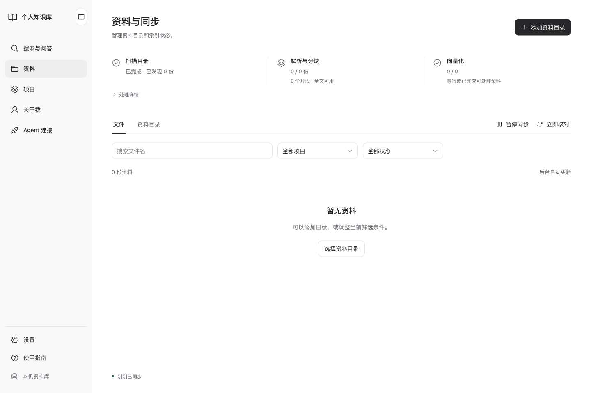
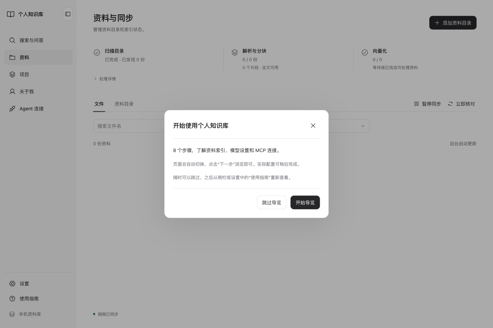
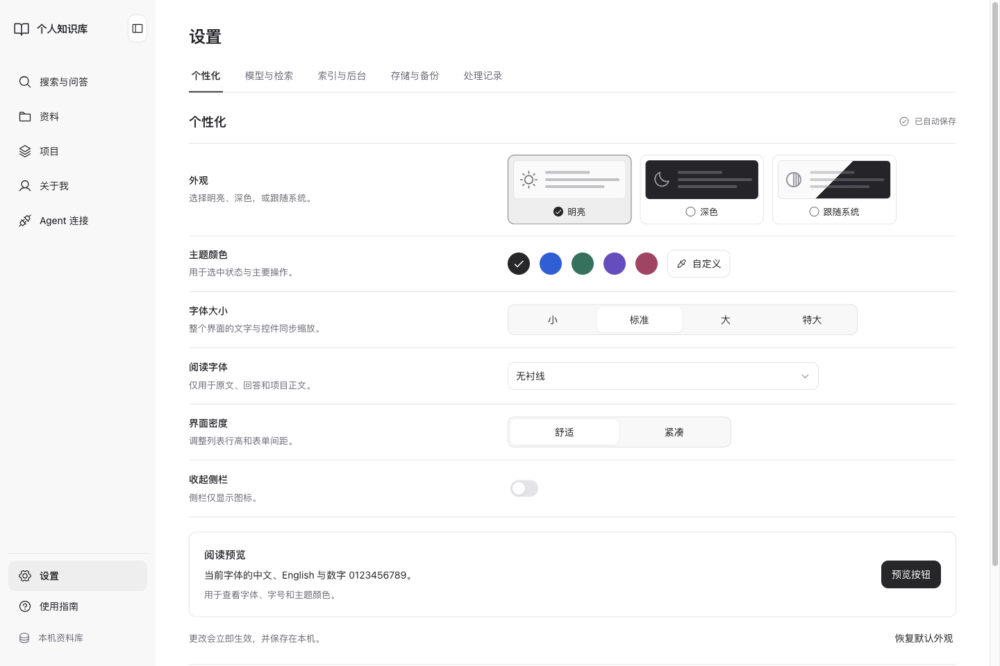

# Personal Knowledge · 个人知识库

[English](README.md) · [简体中文](README.zh-CN.md)

[公开下载与版本说明](https://github.com/JshengZ/personal-ai-knowledge-base/releases) · [完整使用指南](docs/user-guide.zh-CN.md)



支持明亮／深色／跟随系统、主题色、字号与界面密度。[个性化设置](docs/images/appearance.png)即时生效并自动保存。

安装在自己电脑上的知识服务。添加工作资料目录后，应用持续建立索引，通过 MCP 为 ZCode 等 Agent 提供项目背景、原文依据和已确认的个人记忆。资料、数据库和连接凭据保存在本机，不需要 Docker、Python 或终端操作。

## 存储与大目录处理

Windows 安装器支持选择程序目录；首次启动选择独立的数据目录。设置中可迁移已有知识库，复制并校验后才清理旧索引；原始资料保持原位。默认保留 5 GB 可用空间、索引上限 10 GB，可在数据盘容量充足时调整。

资料页分别显示文件处理、文本分块和当前模型向量进度。部门 Embedding API / API Key、随包 Qwen CPU 模型和仅全文三种用法均保留。自动模式的本地预算默认 50,000 个片段，大规模或实测过慢时先保留全文检索；部门 API 不受此本地预算限制，明确选择本地模式也可继续。建议按项目选择资料，排除数据集、缓存和构建产物。

## 安装与使用

1. 从 [Releases](https://github.com/JshengZ/personal-ai-knowledge-base/releases/latest) 下载 [Mac Intel DMG](https://github.com/JshengZ/personal-ai-knowledge-base/releases/download/v1.0.1/Personal-Knowledge-1.0.1-mac-x64.dmg) 或 [Windows x64 安装包](https://github.com/JshengZ/personal-ai-knowledge-base/releases/download/v1.0.1/Personal-Knowledge-1.0.1-win-x64.exe)。Mac 将应用拖入“应用程序”，Windows 使用安装向导选择程序目录，按当前用户安装。首次启动另行选择知识库存储位置，索引、缓存和备份可以放在其他磁盘。
2. 首次启动可查看或跳过内置导览。然后在“资料”页点击“添加资料目录”，选择项目、笔记或文档文件夹。新安装为空知识库，导览可随时从“使用指南”重放。
3. 需要在知识库窗口问答、整理摘要时，在“设置”中填写公司 API 地址、模型名和个人 API Key。只用 MCP 提供资料时，可以稍后配置对话模型，由 ZCode 自己的模型组织回答。
4. 在“Agent 连接”中添加 ZCode，选择共享项目，点击“一键配置 ZCode”。应用会保留已有配置并自动生成备份。然后在 ZCode 新建会话，询问一个真实项目问题并检查工具调用与原文引用。
5. 以后将新文件放进已添加的目录即可。文件修改、重命名、删除也会自动核对。关闭窗口后，应用继续在托盘中运行；从托盘或菜单退出会停止当前服务。Agent 的 stdio 连接可以按需再次启动知识服务。

当前提供 Mac Intel x64 与 Windows x64 目标。Mac 安装包未使用企业证书签名或 Apple 公证；如系统拦截，可通过系统设置的“隐私与安全性”完成打开授权。正式分发可由维护人员使用公司的签名证书构建。Windows 的实际运行与公司环境联调状态请查看 [验收记录](docs/verification.zh-CN.md)，编译成功不代表已经完成公司电脑验收。

## 界面与使用导览

新安装为空知识库。内置 8 步真实界面导览，支持下一步、上一步、跳过与 Escape；可从侧栏或设置重放，退出后恢复原页面和未保存的表单草稿。





[MCP 页面导览](docs/images/onboarding-mcp.png) · [存储位置与容量](docs/images/storage.png) · [主题下拉菜单](docs/images/controls.png) · [连接权限表单](docs/images/actions.png)

截图来自独立空知识库中的实际 Electron 界面，路径标签使用通用名称，不包含个人资料或凭据。

## 可以做什么

- **项目**：按资料目录和 Git 项目整理工作空间，手动维护目标、方案和决定；连接公司模型后生成附资料依据的摘要。
- **搜索与问答**：中文分词全文检索、语义检索、融合排序、可选公司精排；按项目和文件类型筛选。点击来源可查看 PDF 页、代码行、幻灯片、段落或工作表单元格范围。
- **资料与同步**：多个目录、暂停/恢复、立即核对、排除规则、索引失败原因与重试、恢复备份后的目录重新关联。
- **关于我**：维护工作方向、技术经验、偏好和项目决定。模型与 Agent 提交的内容进入待确认列表；依据变化后转为待复核。手动记忆可以修正和删除。
- **Agent 连接**：每个连接独立选择项目、个人记忆和记忆建议权限。支持一键配置 ZCode、通用 JSON、Codex TOML 和本机 HTTP 配置；可以随时停用连接。
- **备份**：从界面导出与恢复 `.pkb` 备份。备份包含索引、项目和记忆；原文件、API Key 和 Agent 连接令牌不随备份迁移。恢复前自动保存一份恢复点。

它通过检索和可追溯记忆积累背景知识，不会训练或修改公司的大模型。Agent 是否使用知识库取决于客户端的工具调用；连接页面提供可复制的使用规则。工作岗位、算法经验等推断需要证据和本人确认。

## RAG 使用哪些模型

| 环节                 | 默认行为                                                                    | 可配置项                               |
| -------------------- | --------------------------------------------------------------------------- | -------------------------------------- |
| 文件解析与 OCR       | 本机解析；中英文 OCR 资源随包提供                                           | OCR 开关、文件大小、目录排除规则       |
| 全文检索             | SQLite FTS5 + Jieba 中文分词                                                | 始终可独立使用                         |
| 向量化               | 有公司 Embedding 配置时使用公司接口；否则使用随包 Qwen3-Embedding-0.6B Q8_0 | 切换为固定本地模式或仅全文检索         |
| 本地推理             | llama.cpp，CPU 运行，无需安装本地聊天大模型                                 | 初次索引耗时取决于资料数量和电脑性能   |
| 融合检索             | 全文与向量候选使用 RRF 融合                                                 | 可选择公司 Rerank 接口                 |
| 问答、摘要、记忆建议 | 用户配置的公司模型                                                          | OpenAI 兼容接口或 Anthropic Messages   |
| Agent 回答           | Agent 自己配置的模型                                                        | MCP 返回资料与上下文，不接管客户端模型 |

本地 Qwen 检索模型为 1024 维，模型文件约 610 MiB。公司模型的名称以公司实际部署为准，应用不内置任何公共商业模型账号或 Key。如果已配置的公司向量接口发生故障，会明确提示并保留全文检索；不会将资料自动转送到其他服务商。

## 数据范围

仅监听主动添加的目录及其子目录。应用默认排除 Git 内部目录、依赖目录、构建产物和常见凭据文件，也支持自定义 glob。重叠目录需要通过已有目录管理，以保持清晰的授权边界。

每个目录有三个使用范围：

- **仅本机检索**：允许本地索引与窗口检索，原文不进入公司模型或 MCP。
- **允许公司模型**：可以用于公司问答、摘要、向量化与精排，MCP 不可读取。
- **允许公司模型与 Agent**：在公司模型范围上，再按连接共享的项目开放 MCP。

索引数据库包含提取的资料文本，应与原资料同等保管。API Key 存入当前用户的 macOS 钥匙串或 Windows 凭据管理器。服务仅监听 `127.0.0.1`，管理端与每个 Agent 使用独立凭据。安装包不包含个人资料、测试数据库或个人 Key；运行时不自动上传到 GitHub、不启用遥测或公共云同步。

## 文件支持与边界

支持 PDF、DOCX、PPTX、XLSX、CSV/TSV、Markdown、常见文本与代码、Jupyter Notebook，以及中英文图片/扫描 PDF OCR。Excel 使用已有公式计算结果，Notebook 不索引执行输出。加密文档需先解密；旧版 `.doc/.xls/.ppt` 请先导出为现代格式。压缩包、视频和音频未作为资料类型接入。

默认每文件上限 32 MB，可在设置中调整。OCR 对超大页面和图片设有资源限制，失败原因会显示在资料页。当前界面备份上传上限为 512 MB，恢复的数据库上限为 1 GiB。索引增大时可按工作目录拆分，并由维护人员扩展备份与检索存储实现。删除资料目录只移除索引，不删除原文件。

## 分享给同事

将对应平台的安装包通过公司内部文件渠道分发。每位同事安装后选择自己的目录，填写自己的凭据；不会继承制作者的个人知识库。

维护人员可以使用 `resources/company-config.json` 制作公司配置包，预填组织名称、API 地址、模型和协议。打包脚本只接受这些白名单字段，不打包 Key、个人目录或令牌。普通使用者仍通过图形界面完成安装和首次设置。

## 开发与维护

技术栈为 Electron、React、TypeScript、Rust、Axum、SQLite、sqlite-vec、Jieba、官方 MCP SDK、PDF.js、Tesseract.js、llama.cpp 和 Qwen3。代码按 Apache-2.0 提供；第三方许可见 `THIRD-PARTY-NOTICES.md` 与 `licenses/`。

仅维护人员需要以下命令，最终用户不需要开发工具：

```sh
npm ci
npm run assets
npm run assets:win-runtime
npm run dev
npm run check
npm test
npm run test:integration
npm run dist:mac
npm run dist:win
```

Rust 版本由 `rust-toolchain.toml` 固定。Mac 交叉构建 Windows 需要 Windows GNU Rust target、cargo-zigbuild 和 Zig；Windows 本机构建可以使用 Rust MSVC 工具链。完整资源含约 610 MiB 的 Qwen 模型、CPU 推理运行文件和 OCR 语言数据。开发用下载镜像只参与构建，不是应用的资料接收地址。

目录与接口约定见 [架构设计](docs/architecture.zh-CN.md)。发布前完成 [验收记录](docs/verification.zh-CN.md) 中的公司环境检查，并保留对应安装包校验和。源码与安装包通过本仓库和 GitHub Releases 公开分发；个人知识数据不参与发布。构建细节见 [开发与发布](docs/development.zh-CN.md)。
