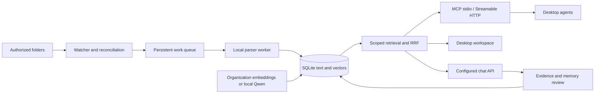

# Architecture and extension points

[English](architecture.md) · [简体中文](architecture.zh-CN.md) · [Home](../README.md)

## Process boundaries

**Electron** owns native windows, tray behavior, folder dialogs, clipboard, login startup, backup dialogs, and local service startup. The context-isolated, sandboxed React renderer calls a narrow preload IPC interface; it does not receive the owner's bearer token.

**The Rust engine** is a standalone executable. A per-user service-discovery file and process lock support desktop operation and on-demand stdio MCP startup. Network listeners are loopback-only. Owner and client credentials are distinct.

**The parser** runs as a persistent NDJSON worker using Electron's bundled Node runtime. Individual document failures do not terminate the queue. Parser files, static web assets, and runtime Node dependencies are unpacked as ordinary files for the Rust process. OCR languages and fonts are local resources.

## Modules

| Module                      | Responsibility                                                                  |
| --------------------------- | ------------------------------------------------------------------------------- |
| `engine/src/indexer.rs`     | Notifications, scans, exclusions, versions, persistent work, and embedding jobs |
| `desktop/parser.mjs`        | Parsing formats into text blocks with stable source locations                   |
| `engine/src/store.rs`       | Schema, transactions, FTS, vector distance, jobs, and events                    |
| `engine/src/retrieval.rs`   | Candidate fusion, reranking, context budgets, reads, and proposals              |
| `engine/src/state.rs`       | Dynamic permissions, source freshness, service state, and maintenance locks     |
| `engine/src/models.rs`      | API adapters, OS credentials, local inference lifecycle                         |
| `engine/src/knowledge.rs`   | Summaries, evidence, memory review, and revision history                        |
| `engine/src/mcp.rs`         | Official SDK stdio and Streamable HTTP transports                               |
| `engine/src/connections.rs` | Client tokens/configuration and preserving existing ZCode settings              |
| `engine/src/backup.rs`      | Consistent snapshots, recovery points, portable restore                         |
| `src/pages/`                | Setup, projects, search, sources, memories, clients, and settings               |
| `scripts/`                  | Resources, checksums, local development, packaging, and release audits          |

## Update consistency

Events enter a SQLite work queue. Paths are deduplicated and failures retry with backoff. Startup and periodic scans compensate for missed events, sleep, and downtime. Deleting a file removes its text and vectors; renames are reconciled through old/new paths.

The indexer checks content hashes before and after parsing, then replaces a document and its chunks transactionally. Source reads check authorization, availability, size, modification time, status, and version. Changed originals are withheld while refreshing. Dependent summaries and confirmed memories become stale for regeneration or review.

Maintenance locks coordinate indexing and restore. Restore first creates a recovery snapshot, then disables roots and credentials and clears client connections until the user relinks them.

## Retrieval and model boundaries

FTS5 indexes Jieba-pretokenized text. Vector records include model identity and dimensions; incompatible embeddings are not mixed. SQL candidate selection applies root/project scope before ranking. RRF combines lexical and semantic results, followed by optional API reranking and source deduplication. Reads recheck live permissions and source state.

Current vector retrieval uses sqlite-vec scalar cosine distance for exact ranking of authorized candidates. It is intended for personal work collections, not a claim of million-document capacity. Larger deployments can preserve `SearchRequest`, `SearchHit`, and MCP contracts while replacing `Store::save_embedding/vector_candidates` with partitioned vec0 tables or another vector store.

Provider differences belong in `Models`. Chat, embeddings, and reranking are independently configured. Local-only sources are excluded from organization-model calls and agent access. Failure reports are explicit; full-text retrieval remains usable.

## MCP contract

| Tool             | Purpose                                                                        |
| ---------------- | ------------------------------------------------------------------------------ |
| `get_context`    | Task-relevant sources, valid project summaries, and visible confirmed memories |
| `search`         | Natural-language/keyword search with project, extension, and time filters      |
| `read_source`    | Read a document/chunk with pagination, location, and version                   |
| `list_projects`  | Authorized projects and valid summaries                                        |
| `propose_memory` | Submit a pending suggestion for the owner's review                             |

The official Rust MCP SDK exposes tool JSON Schemas. Future optional fields should be additive; breaking changes need versioning. Permissions are reloaded during requests, so revocation affects existing sessions. Audit updates cannot overwrite connection permissions.

## Extension guide

- **Formats:** emit the parser's `{blocks: [{text, location}], ocr}` contract, add the extension whitelist entry, and verify with an actual synthetic document.
- **Sources:** create an adapter that supplies stable IDs, source versions, authorization, and queue jobs. Current sources are local folders; there are no online enterprise-document connectors yet.
- **Models:** add protocol adaptation, identity/dimensions, credentials, and actionable errors inside `Models`.
- **Clients:** prefer the existing MCP contract. Client-specific config writers belong in `connections.rs` and must preserve/backup prior settings.
- **Scale:** replace candidate storage through the existing methods, benchmark realistic collections, and extend streaming backup support before increasing documented limits.
- **Migrations:** advance SQLite `user_version` with migration and restore checks. Newer unsupported schemas are rejected; backups have a separate format version.

This is a modular codebase, not a runtime plugin marketplace. Public source and generic installers are distributed through GitHub; user knowledge, credentials, and organization-specific configurations remain outside the release process.

## Storage and scheduling in 1.0.1

The Electron bootstrap directory contains a location pointer and instance lock. A selected data home contains SQLite/WAL, worker temporary files, browser session data, logs and backups. Offline migration holds the source service lock, copies a consistent SQLite snapshot, preserves the credential namespace and connection tokens, checks integrity and installs a redirect. Cleanup runs only after the target service starts. Source files and unrecognized files are preserved.

MCP stdio initialization/tool discovery is independent of backend readiness. HTTP protocol handshakes authenticate from a refreshed in-memory client cache and use the bound port without waiting for the database writer. Data operations use bounded blocking workers; query connections have time budgets. CPU tokenization occurs before the write transaction. Embedding jobs seek bounded rowid windows and use monotonic chunk rowids, avoiding repeated scans from the beginning.

Incremental SQLite counters track documents, chunks, current-model vectors, queue entries and document status. A legacy library gets a background, snapshot-consistent counter backfill. Progress is not recomputed by scanning every chunk during each UI poll. Local auto-mode budgets do not restrict organization Embedding APIs, and explicit local mode retains the CPU model. Windows child workers belong to an engine-owned kill-on-close Job Object; graceful shutdown cancels parsing/model startup, and the desktop waits for service exit before releasing its own files.

Additional modules: `storage.rs` (capacity/migration), `progress.rs` (local-work policy and measured estimates), `counters.rs` (incremental statistics), `processes.rs` (worker lifecycle), `logging.rs` (two-file rolling log). Parsing remains an adapter boundary; adding a heavier optional parser requires platform packaging, licensing and extraction-quality acceptance.

Offline migration persists a source journal and matching copy-ownership marker for copying, ready and published phases. An incomplete owned stage is reclaimed only under the exclusive source lock after proving the original is complete and unchanged. Explicit retries can reuse verified complete copies. Paused interrupted migrations suppress automatic cleanup writes that would change the source revision. Successful target startup and redirect verification remove temporary tracking. VACUUM is not used to reorder chunk rowids.

Capacity quotas count live SQLite pages plus WAL while exposing physical and reusable bytes separately. Reconciliation can process exclusions/deletions when growth is blocked. Durable removing tombstones revoke reads before reclamation; cleanup transactions handle at most 64 chunks with a 4 MiB payload target. Version/root checks prevent stale jobs deleting reindexed content, and low disk or pinned WAL conditions defer cleanup.

The twelve-second response budget applies only to short reads. Summaries, model tests and restore operations await definite outcomes instead of reporting a timeout while a worker still commits. Restore copies validated, allowlisted data into a fresh canonical schema, rebuilding FTS and counters without importing arbitrary triggers, transient cleanup jobs or connection credentials.

The model manager owns its local child before the first health-check await, so a timed-out query can leave the same process warming for the next query. Embedding identity tracks differences in effective endpoint/protocol; default compatible routes retain legacy identities, while changed routes isolate old vectors.

The built-in guide uses steps in `src/guide.ts` and stable data-guide anchors on real controls, changing only the view/settings tab. A native dialog provides modal semantics; cards avoid targets and scroll their body in constrained windows while retaining navigation controls. React Activity preserves visited form state and cleans hidden effects. Completion/dismissal is saved transactionally through `/api/onboarding`, separately from provider drafts, with visible retry on failure.

Installer metadata identifies the checked-out source commit. In CI, a small allowlist of generated runtime-manifest/icon outputs may differ; their SHA-256 values are recorded separately. Any code or other unexpected working-tree change leaves the source unverified and fails the installer provenance check.

## Collections, dynamic scopes and rule consistency

Schema 2 adds `Project.root_id`, archived project metadata, `Root.filters`, and `Connection.scope_mode`. Missing legacy scope modes default to `selected`; new connections default to an empty `selected` scope unless `all` is explicitly requested. Effective access still intersects enabled collections, their local/company/agent policies, project availability and independent memory permissions. Migration updates metadata only and preserves chunk IDs, vector identity and connection tokens.

`collections.rs` associates legacy projects and archives deleted ownership. `rules.rs` is the common predicate for scans, filesystem events, queued parsing, cleanup and source reads, including ancestor links and canonical paths. `library_revision` invalidates stale UI results, interrupts outdated embedding work and restarts bounded cleanup discovery. Collection removal archives metadata and revokes access immediately, before deferred chunk/vector reclamation.

CPU tokenization runs outside the library and database write locks. Initial index records and final commits briefly serialize with root changes through `library_lock`; final commits re-read ownership and rules and update the latest project instead of writing a pre-parse snapshot. Summaries, vector commits and cleanup use the same ordering. Old-root jobs cannot complete jobs for a newly re-added collection at the same path. Native multi-folder IPC returns the full path array; batch APIs report individual successes/failures.

## 1.1.0 query, indexing and lifecycle boundaries

`queries.rs` executes every stdio/HTTP tool through the shared daemon. Six normal query lanes and two reserved keyword lanes are separate from indexing. UI reads also have capacity separate from mutations. WAL read connections bypass the index writer mutex; SQLite progress handlers, loop checks and model cancellation enforce query deadlines. Parsing/tokenization/indexing stay off the protocol event loop. Native notify events reconcile changed paths/subtrees, with hourly full reconciliation as recovery.

Schema 3 jobs persist observations, generations and due times. Repeated observations do not postpone quiet time; changed observations advance the generation, and an old completion/retry cannot consume a newer job. Text-identical chunks reuse IDs/vectors. New IDs avoid all historical and current allocations, and commits reject duplicate/misowned/conflicting IDs, including recovery from partial cleanup. Listing compiles collection rules once and caches directory checks without reopening every indexed file. Scans and source/MCP reads retain complete live content, link, scope and permission checks.

Online restore holds the maintenance writer and invalidates the read pool before/after copying. Pool epochs discard late-returned old readers. State/document snapshots take the maintenance reader to prevent mixed restored metadata. Shutdown joins background workers before releasing parser/model children and the discovery file. Windows Job Objects enforce child lifetime; valid per-session stdio bridges are not treated as orphan daemons.

`diagnostics.rs` supplies lightweight `/api/status` and bounded asynchronous auditing with computation/cancellation/transport phases; transport handoff cannot prove client acknowledgement. `network.rs` centralizes static system/environment proxy routing, bypass and direct mode; loopback is explicitly direct. `package.json` is the version source, synchronized to Cargo/locks; MCP inherits the compiled version, and Windows build.rs emits PE product/file versions verified by the native package audit.

Counter snapshots use RAII transactions, so early returns and errors roll back. Pool return clears cancellation callbacks and rolls back any remaining transaction; rollback failures discard the connection. This prevents stale reads and pinned WAL snapshots. The SQLite dependency also includes the upstream WAL-reset fix; writer/checkpoint serialization remains. [Upstream note](https://sqlite.org/wal.html#walreset).
