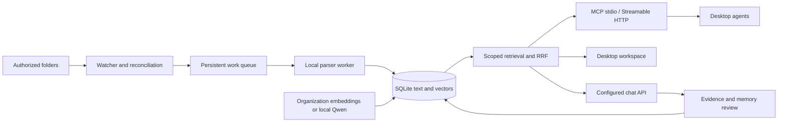

# Architecture and extension points

[English](architecture.md) · [简体中文](architecture.zh-CN.md) · [Home](../README.md)

## Process boundaries

**Electron** owns native windows, tray behavior, folder dialogs, clipboard, login startup, backup dialogs, and local service startup. The context-isolated, sandboxed React renderer calls a narrow preload IPC interface; it does not receive the owner's bearer token.

**The Rust engine** is a standalone executable. A per-user service-discovery file and process lock support desktop operation and on-demand stdio MCP startup. Network listeners are loopback-only. Owner and client credentials are distinct.

**The parser** runs as a persistent NDJSON worker using Electron's bundled Node runtime. Individual document failures do not terminate the queue. Parser files, static web assets, and runtime Node dependencies are unpacked as ordinary files for the Rust process. OCR languages and fonts are local resources.

## Modules

| Module | Responsibility |
| --- | --- |
| `engine/src/indexer.rs` | Notifications, scans, exclusions, versions, persistent work, and embedding jobs |
| `desktop/parser.mjs` | Parsing formats into text blocks with stable source locations |
| `engine/src/store.rs` | Schema, transactions, FTS, vector distance, jobs, and events |
| `engine/src/retrieval.rs` | Candidate fusion, reranking, context budgets, reads, and proposals |
| `engine/src/state.rs` | Dynamic permissions, source freshness, service state, and maintenance locks |
| `engine/src/models.rs` | API adapters, OS credentials, local inference lifecycle |
| `engine/src/knowledge.rs` | Summaries, evidence, memory review, and revision history |
| `engine/src/mcp.rs` | Official SDK stdio and Streamable HTTP transports |
| `engine/src/connections.rs` | Client tokens/configuration and preserving existing ZCode settings |
| `engine/src/backup.rs` | Consistent snapshots, recovery points, portable restore |
| `src/pages/` | Setup, projects, search, sources, memories, clients, and settings |
| `scripts/` | Resources, checksums, local development, packaging, and release audits |

## Update consistency

Events enter a SQLite work queue. Paths are deduplicated and failures retry with backoff. Startup and periodic scans compensate for missed events, sleep, and downtime. Deleting a file removes its text and vectors; renames are reconciled through old/new paths.

The indexer checks content hashes before and after parsing, then replaces a document and its chunks transactionally. Source reads check authorization, availability, size, modification time, status, and version. Changed originals are withheld while refreshing. Dependent summaries and confirmed memories become stale for regeneration or review.

Maintenance locks coordinate indexing and restore. Restore first creates a recovery snapshot, then disables roots and credentials and clears client connections until the user relinks them.

## Retrieval and model boundaries

FTS5 indexes Jieba-pretokenized text. Vector records include model identity and dimensions; incompatible embeddings are not mixed. SQL candidate selection applies root/project scope before ranking. RRF combines lexical and semantic results, followed by optional API reranking and source deduplication. Reads recheck live permissions and source state.

Current vector retrieval uses sqlite-vec scalar cosine distance for exact ranking of authorized candidates. It is intended for personal work collections, not a claim of million-document capacity. Larger deployments can preserve `SearchRequest`, `SearchHit`, and MCP contracts while replacing `Store::save_embedding/vector_candidates` with partitioned vec0 tables or another vector store.

Provider differences belong in `Models`. Chat, embeddings, and reranking are independently configured. Local-only sources are excluded from organization-model calls and agent access. Failure reports are explicit; full-text retrieval remains usable.

## MCP contract

| Tool | Purpose |
| --- | --- |
| `get_context` | Task-relevant sources, valid project summaries, and visible confirmed memories |
| `search` | Natural-language/keyword search with project, extension, and time filters |
| `read_source` | Read a document/chunk with pagination, location, and version |
| `list_projects` | Authorized projects and valid summaries |
| `propose_memory` | Submit a pending suggestion for the owner's review |

The official Rust MCP SDK exposes tool JSON Schemas. Future optional fields should be additive; breaking changes need versioning. Permissions are reloaded during requests, so revocation affects existing sessions. Audit updates cannot overwrite connection permissions.

## Extension guide

- **Formats:** emit the parser's `{blocks: [{text, location}], ocr}` contract, add the extension whitelist entry, and verify with an actual synthetic document.
- **Sources:** create an adapter that supplies stable IDs, source versions, authorization, and queue jobs. Current sources are local folders; there are no online enterprise-document connectors yet.
- **Models:** add protocol adaptation, identity/dimensions, credentials, and actionable errors inside `Models`.
- **Clients:** prefer the existing MCP contract. Client-specific config writers belong in `connections.rs` and must preserve/backup prior settings.
- **Scale:** replace candidate storage through the existing methods, benchmark realistic collections, and extend streaming backup support before increasing documented limits.
- **Migrations:** advance SQLite `user_version` with migration and restore checks. Newer unsupported schemas are rejected; backups have a separate format version.

This is a modular codebase, not a runtime plugin marketplace. Public source and generic installers are distributed through GitHub; user knowledge, credentials, and organization-specific configurations remain outside the release process.
