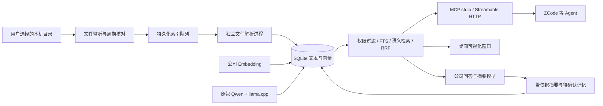

[English](architecture.md) · [简体中文](architecture.zh-CN.md)

# 实现结构与扩展约定

## 运行结构

Electron 负责窗口、托盘、目录选择、剪贴板、自启动、备份文件对话框和本机服务生命周期。React 只通过受限 preload IPC 调用桌面管理接口；管理令牌不进入渲染进程。开发预览使用 Vite 本机代理，开发数据目录不允许作为静态文件读取。

Rust 知识服务是可独立运行的可执行文件。关闭窗口不影响后台索引；stdio MCP 启动器通过当前用户的服务发现文件找到服务，必要时启动它。服务绑定回环地址，通过文件锁避免重复实例，通过随机令牌区分所有者与各个客户端。

解析使用 Electron 自带的 Node 运行时和随包依赖。解析器、前端静态文件与 Node 依赖解包为普通文件，供 Rust 子进程访问。资料文本由持久化 NDJSON 工作进程解析，单份文档失败不会终止后续队列。OCR 语言资源、本地字体和模型均随安装包提供。

## 模块职责

| 位置                        | 职责                                                     |
| --------------------------- | -------------------------------------------------------- |
| `engine/src/indexer.rs`     | 通知监听、全量核对、排除规则、内容版本、索引与向量队列   |
| `desktop/parser.mjs`        | 统一解析结果，保留页码、代码行、段落、幻灯片和单元格位置 |
| `engine/src/store.rs`       | 数据迁移、事务、FTS、向量距离、任务和事件记录            |
| `engine/src/retrieval.rs`   | 检索请求、融合与精排、上下文预算、原文读取、记忆建议     |
| `engine/src/state.rs`       | 服务状态、动态权限核对、维护锁与资料有效性验证           |
| `engine/src/models.rs`      | 公司协议适配、系统凭据、本地推理服务生命周期             |
| `engine/src/knowledge.rs`   | 带来源摘要、记忆确认、修订与证据失效                     |
| `engine/src/mcp.rs`         | 官方 SDK stdio 与 HTTP MCP 传输                          |
| `engine/src/connections.rs` | 连接令牌、客户端配置、保留与备份 ZCode 原配置            |
| `engine/src/backup.rs`      | 一致性数据库快照、恢复前备份、凭据与连接隔离             |
| `src/pages/`                | 项目、检索、资料、个人记忆、Agent、设置和首次向导        |
| `scripts/`                  | 资源校验、开发启动、桌面构建与安装包                     |

## 文件更新一致性

通知事件进入 SQLite 队列；同一路径合并任务，失败使用退避重试。默认每五分钟核对所有授权目录，应用重启也会核对，以补偿休眠和离线期间丢失的事件。文件重命名按新旧路径更新，删除会清理 FTS、片段与向量。

解析前后核对内容哈希，成功后在事务中替换文档与片段，避免一半新、一半旧的索引。原文件大小或修改时间变化时，读取接口拒绝返回旧片段并安排刷新。引用该资料的项目摘要与已确认记忆会失效，等待重新生成或本人复核。

## 检索与模型隔离

FTS5 使用 Jieba 预分词；向量存储携带模型标识和维度，查询只使用匹配模型与维度的记录。全文与向量候选在 SQL 层按目录和项目过滤，再做 RRF 融合、可选公司精排与来源去重。读取结果再次检查当前连接权限、原文件可用性和版本。

当前向量搜索通过 sqlite-vec 的余弦距离对获准候选做精确排序，适合个人工作资料；没有宣称支持百万文档。需要更大规模时，可保留 `SearchRequest`、`SearchHit` 和 MCP 契约，替换 `Store::save_embedding/vector_candidates`，引入 vec0 表分区或独立向量引擎。更换模型不会混用旧向量。

公司 API 适配集中在 `Models`，现有 chat、embedding、rerank 分开配置。新增服务商应在该边界适配，避免让 UI、索引器或 MCP 理解厂商细节。模型错误返回可读状态，全文检索可继续使用。

## MCP 契约

| Tool             | 用途                                                         |
| ---------------- | ------------------------------------------------------------ |
| `get_context`    | 按任务返回资料、项目摘要与可见的已确认记忆，建议作为首个调用 |
| `search`         | 自然语言/关键词检索，可按项目、扩展名与更新时间筛选          |
| `read_source`    | 读取指定文档或片段，支持分页并返回位置和版本                 |
| `list_projects`  | 返回当前连接获准读取的项目及有效摘要                         |
| `propose_memory` | 将 Agent 建议写入待确认区，不直接确认为个人事实              |

传输层采用官方 Rust MCP SDK。工具字段通过 JSON Schema 暴露，JSON 结果可在未来增加可选字段；破坏性修改应增加协议版本。Agent 权限在请求时重新读取，停用或缩小范围后对已有会话生效。后台审计只更新最近调用时间，不覆盖权限设置。

## 后续扩展位置

- 新文件格式：在解析器中输出相同的 `{blocks: [{text, location}], ocr}` 结构，补充实际格式样例测试。将新扩展名加入索引器白名单。
- 新来源：先实现将来源状态、版本和任务写入索引队列的适配器；保留授权范围与稳定文档 ID。现有版本只接入本机目录，不包含在线企业文档连接器。
- 新模型服务：扩展 `Models`，支持明确的模型标识、维度、凭据与错误信息。
- 新客户端：优先复用 MCP；客户端专属配置写入器放在 `connections.rs`，必须保留原配置和生成备份。
- 更大数据集：基于现有检索方法边界替换候选存储，增加流式备份接口和大数据集基准。当前没有通用的运行时插件市场。
- 数据迁移：SQLite `user_version` 控制，应用拒绝打开更高版本数据库；新增迁移需提供升级及恢复验证。备份有独立格式版本。

## 打包与组织配置

打包只选取目标平台的知识服务、推理运行文件、共享模型和 OCR 数据。个人数据位于系统用户数据目录，开发数据位于 `.local/`，不进入安装包。组织模板只允许 API 地址、模型名、协议、接口路径、组织名称和模式开关，凭据永远由安装后的用户保存。

公开源码与通用安装包通过仓库和 Releases 分发；不要把个人知识、公司专用配置、遥测或个人数据同步加入发布流程。企业内部分发可以独立设置签名与分发渠道。对安装包的实机验收、实际公司 API 和实际客户端联调，需要在对应环境完成并更新验证记录。

## 1.0.1 的存储与调度

Electron 原用户目录保留位置指向和实例锁；选定数据目录承载 SQLite/WAL、解析临时文件、浏览器会话数据、日志与备份。离线迁移持有源服务锁，复制一致的 SQLite 快照、保留凭据命名空间和连接令牌、校验后写入指向；新服务启动后才清理旧文件。原始资料和未知文件保留。

stdio 初始化/工具发现独立于后端就绪状态；HTTP 握手使用及时刷新的客户端授权缓存及已绑定端口，不等待数据库写锁。数据操作由有并发上限的阻塞工作线程承载，独立查询连接有时间预算。分词移到写事务之前，向量任务按单调 rowid 的窗口顺序处理，避免每批从头扫描。

SQLite 增量计数覆盖文件、片段、各模型向量、队列和文档状态；旧库通过后台一致快照补齐统计，不在每次界面刷新时遍历百万片段。自动模式的本地预算不限制部门 API，明确选择本地仍保留 CPU 模型。Windows 子进程加入由引擎持有的 kill-on-close Job Object；退出可取消解析/模型启动，桌面端等待服务退出后才释放自身文件。

新增模块：`storage.rs`（容量/迁移）、`progress.rs`（本地策略与估算）、`counters.rs`（增量统计）、`processes.rs`（子进程生命周期）、`logging.rs`（双文件滚动日志）。解析层继续保持适配器边界，增强解析器需单独验证平台打包、许可及提取质量。

离线迁移持久化源作业和副本归属标记，区分复制中、完整待切换、已发布阶段。仅在独占源锁、确认原数据仍完整且版本相同后清理本作业的不完整暂存；完整副本可在明确重试时复用。迁移待重试且同步暂停时，不自动运行会改变源版本的清理。成功启动并确认指向后清理迁移跟踪信息。不会通过 VACUUM 重排片段 rowid。

容量额度以已用 SQLite 页与 WAL 计量，另保留文件物理大小和空闲页统计。超额不会阻止排除/删除核对；清理先持久化 removing 状态并撤销读取，再以每批最多 64 片段、目标 4 MiB 负载的事务处理。清理核对文档版本与目录，避免旧任务误删重新索引的数据，并在磁盘或 WAL 条件不足时暂缓。

12 秒响应预算只适用于短读取。摘要、模型测试和备份恢复等待确定结果，避免阻塞任务超时后仍悄悄写入。恢复只从已验证备份复制白名单数据至新建标准数据库，重建 FTS 与计数，不安装输入库的触发器、临时清理任务或连接凭据。

本地模型在首次等待健康检查前就由模型管理器持有，单次查询超时后可继续预热。Embedding 标识包含实际接口路径/协议的差异；默认兼容路径保留旧标识，切换到不同接口时隔离旧向量。

内置导览的步骤定义位于 `src/guide.ts`，通过稳定的 data-guide 标记定位真实控件，仅改变前端视图与设置分类。原生 dialog 管理模态语义，卡片避让目标并在短窗口内滚动正文，保留退出与翻页操作。React Activity 保留已访问页面的表单状态并清理隐藏页面的 Effect。完成和跳过通过独立 `/api/onboarding` 接口在事务内保存，失败可重试；不经整页模型设置提交。

安装包元数据记录检出的源码提交。CI 可重新生成受限白名单内的运行时清单和图标，其 SHA-256 单独记录；代码或其他非预期工作区变化会使源码核验失败，并阻止安装包进入发布流程。

## 资料集合、动态范围与规则一致性

数据库版本 2 增加 `Project.root_id`、项目归档状态、`Root.filters` 和 `Connection.scope_mode`。旧记录缺少范围模式时按 `selected` 处理；新连接未明确传项目列表时默认 `all`。最终权限仍与启用状态、目录 local/company/agents 用途、项目可用性和独立记忆授权取交集。迁移仅补充元数据，保留片段编号、向量及连接令牌。

`collections.rs` 负责旧项目归属修复和移除后的归档；`rules.rs` 统一扫描、监听、队列、清理和原文读取的判定，检查上层链接和规范路径。`library_revision` 让界面丢弃旧结果、取消过时向量任务并重启分批清理发现。移除集合先撤权和归档，片段／向量随后回收。

CPU 分词在资料变更锁和数据库写锁之外执行。创建索引记录与最终提交使用短时 `library_lock` 与目录修改串行；最终复核最新归属与规则，只更新最新项目的索引时间，不覆盖解析前快照。摘要、向量提交和清理遵循相同顺序。旧集合任务不会结束相同路径下新集合的任务。原生多目录 IPC 返回完整数组，批量接口分别报告成功和失败项。
