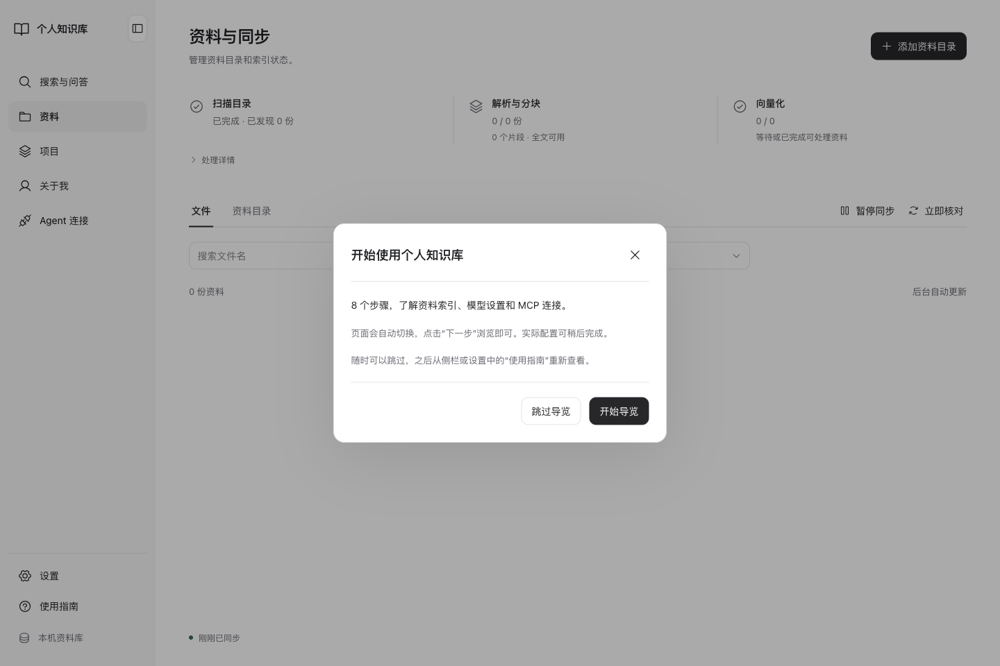
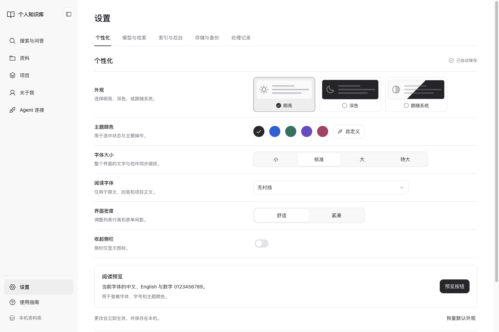

## 简体中文

本次更新完善内置导览和个性化，修复 Windows MCP、索引资源管理与数据迁移问题。新安装从空知识库开始，已移除示例入口和生成能力。

- **使用导览：** 8 步真实界面指引，自动切换页面；支持上一步、下一步、跳过、关闭和 Escape。可从侧栏或设置重新查看，退出后保留原页面、滚动位置和未保存草稿。
- **界面与个性化：** 明亮、深色、跟随系统，预设或自定义主题色、字号、阅读字体、密度和侧栏偏好；统一下拉菜单、焦点、按钮和弹窗布局。
- **Windows 与存储：** 安装目录可选，知识库数据位置独立配置；迁移校验及中断重试；磁盘余量和索引容量保护，分批清理已移除资料。
- **MCP 与索引：** 握手和工具发现不等待后台索引；文件、分块、向量进度分开显示，提供 CPU 占用选项和自动模式预算。继续支持部门 Embedding API/API Key、随包 Qwen CPU 模型和仅全文检索。
- **审查修复：** 完善备份验证、模型生命周期和设置分组保存；修复导览重放后的搜索上下文、并发保存和小窗口布局问题。

### 下载与升级

Windows x64 下载下方 `.exe`；Intel Mac 下载 `.dmg`。两种安装包均包含运行时、本地 Embedding 模型和中英文 OCR，无需命令行安装。原生 Apple Silicon 和 ARM Windows 暂不提供。

升级前从托盘退出旧程序。已有资料库会保留；大型旧库建议先选“仅全文”，核对资料范围和排除规则，并在“设置 → 存储与备份”检查容量或迁移位置。不要直接删除 SQLite WAL/SHM 文件。安装包未签名，系统可能提示未知发布者。

[中文使用指南](https://github.com/JshengZ/personal-ai-knowledge-base/blob/v1.0.1/docs/user-guide.zh-CN.md) · [架构说明](https://github.com/JshengZ/personal-ai-knowledge-base/blob/v1.0.1/docs/architecture.zh-CN.md) · [验收记录](https://github.com/JshengZ/personal-ai-knowledge-base/blob/v1.0.1/docs/verification.zh-CN.md) · [完整更新日志](https://github.com/JshengZ/personal-ai-knowledge-base/blob/v1.0.1/CHANGELOG.md)

## English

This release completes the optional built-in guide and appearance settings, and fixes Windows MCP responsiveness, index resource management and recoverable data migration. Fresh libraries are empty; sample entry points and generation have been removed.

- Eight real-interface guide steps with automatic navigation, Previous/Next, Skip, close, Escape and replay. Exiting restores the original view, scroll and unsaved drafts.
- Persistent light/dark/system appearance, preset/custom accents, font size, reading font, density and sidebar preferences; consistent dropdown, focus, action and dialog styling.
- Selectable Windows program directory and independent data location, verified migration/retry, disk reserves, live-index quotas and bounded cleanup.
- Responsive MCP initialization/tool discovery during indexing; separate file/chunk/vector progress, CPU profiles and an automatic local work budget. Organization Embedding APIs, the bundled Qwen CPU model and full-text mode remain available.
- Reviewed backup, model lifecycle and settings fixes; guide regressions for stale search context, concurrent saves and constrained windows.

Download the Windows x64 `.exe` or Intel Mac `.dmg` below. Both bundle their runtime, local embedding model and English/Chinese OCR. Quit the old tray app before upgrading. Installers are unsigned. Native Apple Silicon and ARM Windows packages are not included.

[English user guide](https://github.com/JshengZ/personal-ai-knowledge-base/blob/v1.0.1/docs/user-guide.md) · [Architecture](https://github.com/JshengZ/personal-ai-knowledge-base/blob/v1.0.1/docs/architecture.md) · [Verification](https://github.com/JshengZ/personal-ai-knowledge-base/blob/v1.0.1/docs/verification.md)

## Screenshots / 界面截图

Actual Electron interface in an isolated empty library; path labels are generalized. / 截图来自隔离的空知识库，路径使用通用标签。

## Build verification / 构建验证

<!-- BUILD_VERIFICATION -->

SHA-256 digests and source/build metadata are attached as `SHA256SUMS.txt` and `BUILD-INFO.json`. No personal library, credentials or business documents are bundled. Hosted synthetic checks do not replace acceptance with a real company API, ZCode installation or large private corpus.

附件提供 SHA-256 校验和与源码/构建记录。安装包不含个人资料、凭据或公司文档。云端合成测试不能替代目标公司电脑、真实 API 和 ZCode 客户端的验收。
