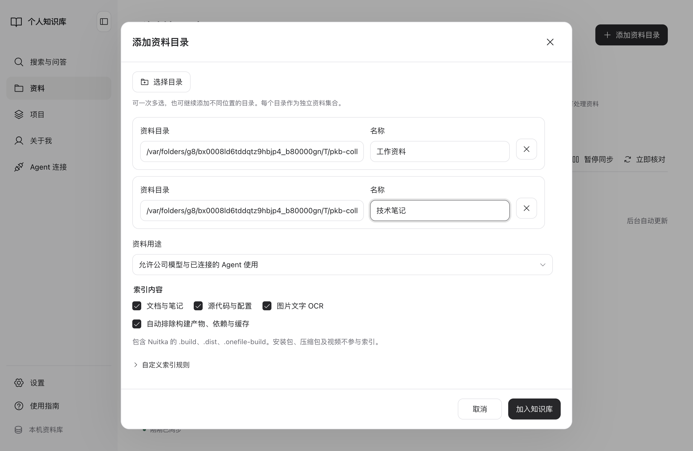
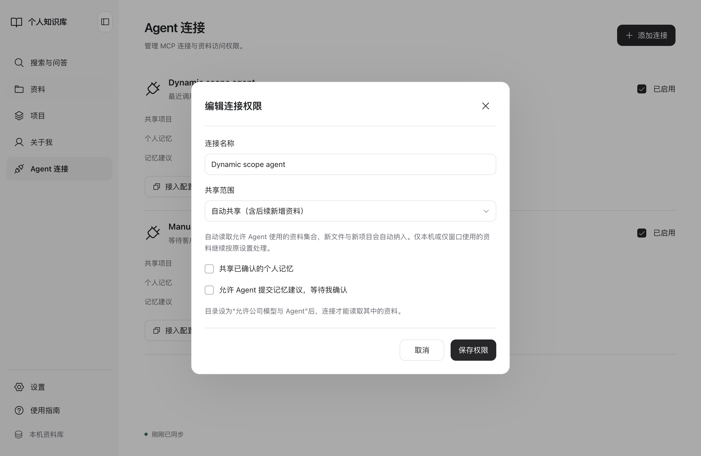

## 简体中文

本次更新完善资料集合、批量目录选择、Agent 自动共享与自适应排除，并修复独立审查发现的索引和交互一致性问题。新安装仍为空知识库，没有示例入口或生成能力。

- **资料集合：** 每个目录保留自定义名称；集合与内部代码项目分别筛选。改名同步到现有搜索结果，移除后立即从下拉、搜索与 MCP 撤销。手写项目背景保留在“已归档项目”。
- **原生批量选择：** Mac／Windows 目录对话框支持多选和追加选择，每目录独立命名；重复、重叠和不可访问目录分别提示，部分失败只重试失败项。长弹窗固定标题和操作区。
- **自动共享：** 新连接默认共享全部允许 Agent 使用的资料和后续新增；旧连接保留原指定范围，可一次切换。目录用途、个人记忆和记忆建议授权仍分别控制。
- **统一排除：** Nuitka `*.build`／`*.dist`／`*.onefile-build`、带明确标记的生成目录、依赖与缓存；不支持的安装包、压缩包、视频和二进制内容跳过。可查看跳过原因，按文件／目录／扩展名排除，或通过相对路径额外纳入。
- **一致性修复：** 最终索引写入重新核对集合与规则；不会把在途解析结果写回已删除集合或覆盖手写背景。目录链接在直接读取时也会检查；旧排除片段和向量在暂停新增同步时仍能分批回收。

### 下载与升级

Windows x64 使用下方 `.exe`；Intel Mac 使用 `.dmg`。均包含运行时、Qwen CPU Embedding 模型与中英文 OCR，无需命令行安装。部门 Embedding API/API Key、显式本地模式与仅全文均保留。

升级前从托盘退出旧程序，并建议导出备份。本版将数据库升级为 **schema 2**，保留片段、向量与 Agent 令牌；升级后使用 v1.0.2 或更新版本。旧连接不会自动扩大范围；在“编辑权限 → 共享范围”切换即可，无需重写现有客户端配置。原始文件保留。

自动识别不能保证覆盖所有未知／改名产物；索引大型目录前请检查资料范围和跳过原因。安装包未签名，暂不提供原生 Apple Silicon／ARM Windows 安装包。

[中文指南](https://github.com/JshengZ/personal-ai-knowledge-base/blob/v1.0.2/docs/user-guide.zh-CN.md) · [架构](https://github.com/JshengZ/personal-ai-knowledge-base/blob/v1.0.2/docs/architecture.zh-CN.md) · [验收记录](https://github.com/JshengZ/personal-ai-knowledge-base/blob/v1.0.2/docs/verification.zh-CN.md) · [更新日志](https://github.com/JshengZ/personal-ai-knowledge-base/blob/v1.0.2/CHANGELOG.md)

## English

Named collections now retain user names separately from detected projects. Native folder multiselect supports per-folder names, accumulated choices, overlap feedback and partial-failure retry. Collection renames update existing hits; removal immediately revokes selectors/retrieval and archives authored project notes.

New MCP connections automatically include eligible collections and future additions. Legacy selected scopes, folder policies and independent memory permissions are preserved. One rule engine covers scans, watching, parsing, cleanup and reads, including Nuitka output suffixes, combined generated markers, categories, binary detection, explicit paths and glob rules. Skip reasons are visible and old excluded chunks/vectors are reclaimed even while discovery is paused.

Independent review verified fixes for in-flight writes after collection deletion, stale hit names, ancestor directory links and editing during a partial batch submission. Long folder dialogs keep headings and actions visible.

Download the Windows x64 `.exe` or Intel Mac `.dmg`. Both bundle the runtime, local Qwen embedding model and English/Chinese OCR. Organization Embedding APIs, explicit local mode and full-text-only mode remain supported. Quit the old tray app and export a backup before upgrading. Database schema advances to **2**, preserving chunk/vector identities and client tokens; use v1.0.2 or newer afterward. Existing selected connections can switch once to automatic scope without regenerating MCP configuration.

Automatic classification cannot identify every unknown/renamed tool output. Review broad folder scopes. Installers remain unsigned; native Apple Silicon and ARM Windows are not included.

[English guide](https://github.com/JshengZ/personal-ai-knowledge-base/blob/v1.0.2/docs/user-guide.md) · [Architecture](https://github.com/JshengZ/personal-ai-knowledge-base/blob/v1.0.2/docs/architecture.md) · [Verification](https://github.com/JshengZ/personal-ai-knowledge-base/blob/v1.0.2/docs/verification.md)

## Screenshots / 界面截图

Actual Electron UI with isolated synthetic acceptance fixtures; these materials are not bundled. / 真实 Electron 界面，资料为隔离验收数据，不随安装包提供。

## Build verification / 构建验证

<!-- BUILD_VERIFICATION -->

`SHA256SUMS.txt` and `BUILD-INFO.json` identify exact sources, build runs, sizes and SHA-256 digests. Only generic source/installers are published; personal libraries, company documents, keys and tokens are excluded. Hosted synthetic checks do not replace acceptance on a real company workstation/API/ZCode client.

附件记录源码、原生构建、大小与 SHA-256 摘要。公开内容只含通用源码与安装包；个人资料库、公司文档、密钥和令牌不上传。云端合成测试不能替代真实公司电脑、API 和 ZCode 客户端验收。
