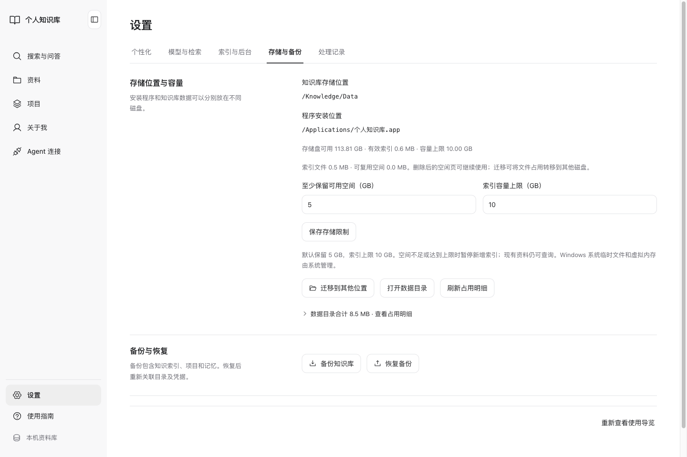
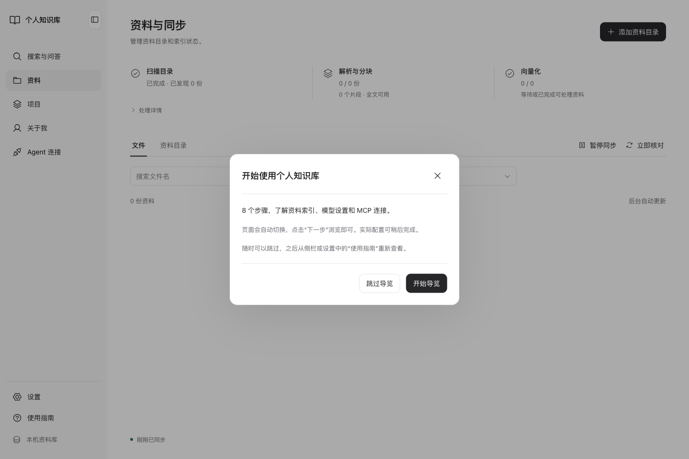
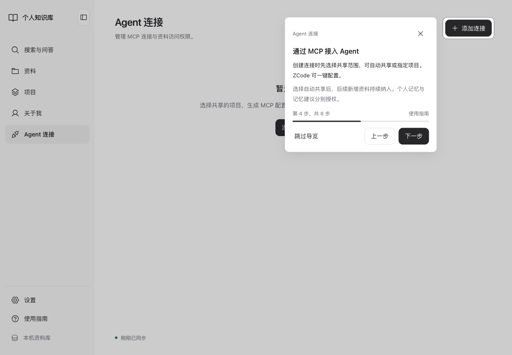
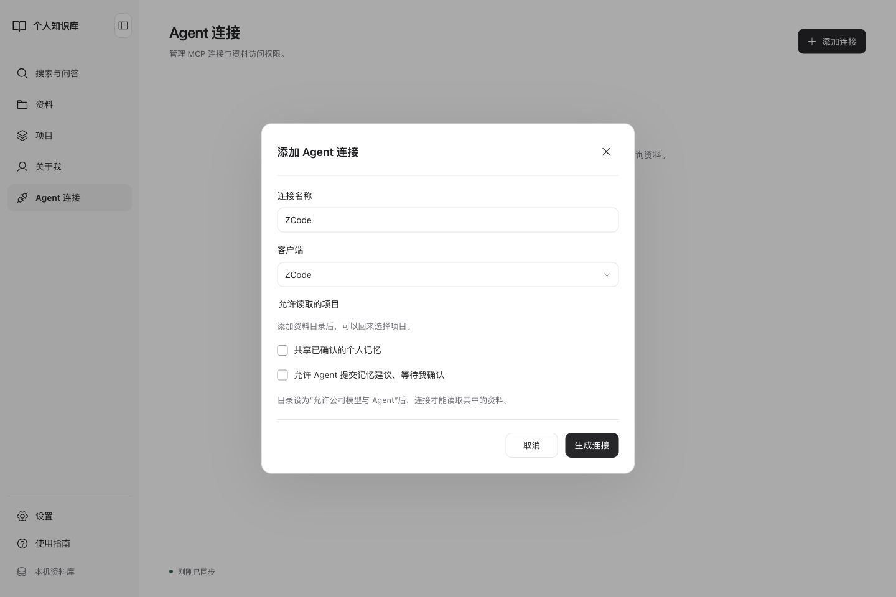
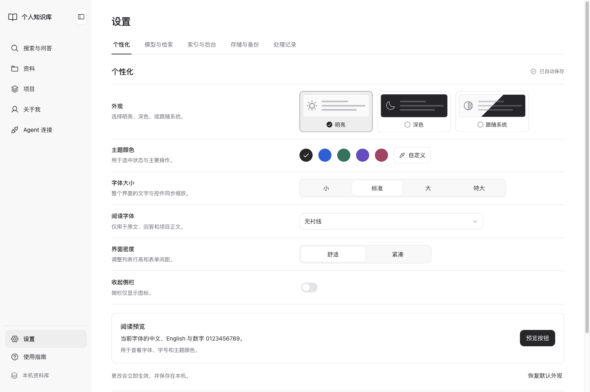

# User guide

[English](user-guide.md) · [简体中文](user-guide.zh-CN.md) · [Home](../README.md)

## Installation

Download your platform's installer from [GitHub Releases](https://github.com/JshengZ/personal-ai-knowledge-base/releases/latest). The source-code ZIP is for developers and is not an installer.

- **Intel Mac:** open the `.dmg`, drag **个人知识库** to Applications, then launch it. If macOS blocks this unsigned build, use System Settings → Privacy & Security to authorize opening the app. No terminal command is required.
- **Windows x64:** run the `.exe` wizard, choose the program directory (for example on D:), and install for the current user. It creates a shortcut. The build is unsigned and may display an unknown-publisher prompt. Managed workstations may require your organization's normal software authorization.

The application bundles its runtime, local embedding model, fonts, and OCR languages. There is no project account to register. Native Apple Silicon and ARM Windows installers are not part of v1.0.1.

## Data location and upgrading

The program directory and knowledge data directory are separate. First launch asks where to store the index, vectors, parser temporary files, browser cache, logs and backups. Choose a local disk with enough free space. The app creates a `Personal-Knowledge` subfolder at the chosen location and shows the exact path.

For an existing library use **设置 → 存储与备份 → 迁移到其他位置**. Migration pauses indexing, shuts down the service, copies the database with SQLite's backup API, verifies integrity and restarts. Old managed indexes/caches are removed only after the relocated service starts. Original source files stay in place. Unknown files in the old folder are preserved. Agent tokens and the credential-store namespace are retained. Existing `--home` configurations follow a small redirect; if the program installation path changes, regenerate client configuration. Migration leaves synchronization paused for review.

Quitting during a move asks you to wait; the app restarts after completion. After a power interruption or forced termination, select the same destination again in Settings. The app checks its migration journal and source revision and can reuse a verified complete copy. Changed sources or unrecognized copies are preserved with an actionable error rather than overwritten.

The bootstrap pointer and instance lock remain in the original per-user application directory. Windows installer temporary files and system virtual memory are managed by Windows; selecting D: is not a promise of zero C: usage. A missing data drive produces an error instead of creating an empty fallback library.

By default, at least **5 GB** of free disk space is reserved and live index pages plus the database journal are limited to **10 GB**. SQLite pages freed by deletion are reusable and do not permanently consume this quota. Settings show live quota usage, physical file size, and reusable space separately. Excluded/deleted sources and removed folders are reclaimed in small background batches without deleting originals; already confirmed removals continue while discovery is paused. Database files generally do not shrink immediately after deletion, and actual disk free space remains protected. Migrate to another disk to move that physical occupation. An existing library is never deleted merely for exceeding its limit.

When upgrading from v1.0.0, quit the tray application first. Install v1.0.1, choose/review storage, and start with **Full-text only** while reviewing a large folder. A manually created junction can remain; the engine resolves its physical path. Do not delete SQLite WAL/SHM files as a disk-cleaning shortcut.

## First use and built-in guide

First launch offers an optional eight-step guide. It navigates the real interface and highlights folders, indexing progress, model settings, MCP connections, search, projects, personal memory and storage. Use Next/Previous to browse. Skip, the close button, and Escape exit at any point; actual folder and model setup can be done later.

Completion or dismissal is stored with the library so it does not repeat on launch. Replay from **使用指南** in the sidebar or **重新查看使用导览** at the bottom of Settings. Exiting restores the previous page, settings tab, scroll position and unsaved form drafts. A failed progress save offers retry while allowing normal use.

The guide only changes presentation and saves its own progress. New installations start with an empty library. There is no sample-data entry point or sample generator.

## First folder

In Sources, click **添加资料目录**, choose a project or document folder with **选择目录**, then **加入知识库**. The app indexes that folder and its descendants. The initial permission allows organization-model and agent use; change it later in **资料 → 资料目录** if needed.

You can add multiple folders. Git working directories and common package/build manifests are recognized as projects. A Git repository remains a unit even when it contains nested packages; unrecognized top-level subfolders become separate collections. Newly indexed/reindexed files use these rules. Existing sources are not all rechunked on upgrade. Review agent project scopes when new projects appear. Overlapping folders are managed through the already-added root. Git internals, dependency directories, build output, and common credential files are excluded by default; add glob exclusions in the folder editor.

The app starts with an empty library. Add your own folders; no sample files are generated.

## Model settings

For in-app chat and project summaries, enter the API base URL, deployed model name, protocol, and optional API key in **设置 → 模型与检索 → 公司模型**. OpenAI-compatible Chat Completions and Anthropic Messages are supported. A custom endpoint can be set in the advanced field. Test the saved settings before using work documents.

For semantic retrieval, choose a mode in **语义检索**:

- **Auto:** use the configured organization Embedding API; otherwise use the bundled Qwen model.
- **Local:** always use the bundled Qwen3-Embedding-0.6B model.
- **Full-text only:** disable vector retrieval.

An organization chat endpoint does not necessarily provide embeddings. Leave the Embedding API blank if none is available. Optional reranking has its own endpoint and model setting. Keys are stored in the OS credential store and are not included in backups or shared installers.

You can skip chat setup when using an agent's existing model: MCP supplies source context and your agent composes the answer.

## Indexing progress and resources

**资料与同步** separates files, extracted chunks and vectors for the current model. Vector totals are library-wide; actual work respects enabled folders and permissions. Rate/ETA appears only after enough measured samples and is an estimate, not a throughput guarantee. Full-text availability does not depend on completing all vectors.

Auto mode keeps the bundled CPU model. Without an Embedding API, it defers background local vectorization above the default **50,000-chunk** budget, or after measuring a slow run expected to exceed two hours. Configure a department Embedding API to continue at that provider's throughput, choose **Local** explicitly to continue on CPU, or choose **Full-text only**. Existing vectors are retained. The local budget does not cap department API processing. API batches default to 32 and are configurable up to 128.

**索引资源占用** offers Low (one model thread), Balanced (up to two) and Performance (up to six, leaving CPU headroom). Parser/model workers use below-normal priority on Windows. The parser heap is limited to 512 MiB; this is a V8 heap setting, not a total application RAM limit. Text overlap is bounded, and short Word paragraphs are grouped with paragraph-range citations.

The bundled CPU worker submits one chunk at a time, so a slow batch does not discard already completed chunks. Its background request allows up to five minutes for a bounded chunk on older CPUs. Pausing or changing retrieval mode cancels active background work. MCP queries retain their short full-text fallback deadline. Department APIs continue to use the configured batch size and API timeout.

## Connect an agent

1. Open **Agent 连接 → 添加连接**.
2. Choose the client and authorized projects. Decide whether it may read confirmed personal memories and submit memory suggestions.
3. For ZCode, click **一键配置 ZCode**. Existing settings are preserved and backed up. For nonstandard installations, copy the generated settings into your client instead.
4. For another client, copy the generated JSON, Codex TOML, or local HTTP settings into its MCP configuration UI.
5. Start a new conversation. Ask: “What algorithm does my ranking project use? Call the knowledge tools and cite the original sources.”

The **测试共享范围** button checks the knowledge service and permissions. Actual integration still needs a tool call from your client. Suggested usage rules in **接入配置** help an agent use the knowledge base proactively.

For a specific codebase, ask the agent to call `list_projects`, select the correct `project_id`, then use `get_context`/`search` and read returned sources. A flat file list does not flatten stored project/path metadata. Label sources separately in cross-project comparisons.

Tools: `get_context`, `search`, `read_source`, `list_projects`, `propose_memory`. Proposals require review; they do not directly become confirmed facts.

## Search, summaries, and memories

- **项目:** review/edit goals, approaches, and decisions; generate an evidence-backed summary using the configured chat API.
- **搜索与问答:** filter by project or file type. Click a result or citation to read its original page, line, paragraph, slide, or cell range.
- **关于我:** confirm, correct, dismiss, or delete memory suggestions. When a source changes, dependent confirmed memories become **待复核**.

Role or skill inferences are suggestions supported by sources. They do not train a model or establish a verified job title.

## Synchronization and backup

New files, modifications, renames, and deletions are tracked inside authorized folders. Periodic reconciliation also catches events missed during sleep or downtime. Use **立即核对**, **暂停同步**, and **继续同步** to control processing. Errors and retry controls appear in the source view.

Closing the window keeps the tray service running. Use the tray or app menu to quit. Enable login startup in Settings if desired. A stdio MCP client can start the service when needed.

Use **设置 → 备份知识库** to export `.pkb` and **恢复备份** to restore it. Original files, API keys, and agent tokens are not transferred. Restore validates the schema and record content and imports allowed data into a fresh canonical database before replacing the live library. It creates a recovery snapshot, pauses synchronization, disables roots, and requires relinking folders, re-entering credentials, and recreating client connections.

## Troubleshooting and boundaries

| Situation                        | What to check                                                                           |
| -------------------------------- | --------------------------------------------------------------------------------------- |
| Sources appear without an answer | Configure the chat API, or let your MCP agent answer from sources.                      |
| Only keyword retrieval           | Check retrieval mode and its connection test; vector indexing may still be running.     |
| An agent sees no sources         | Check folder policy, project scope, connection status, and indexing progress.           |
| A source is unavailable          | Wait for indexing or reconnect the drive; stale/inaccessible originals are withheld.    |
| A document fails                 | Check the source-list error; decrypt protected files and convert legacy Office formats. |
| A model connection fails         | Check network, protocol, model name, endpoint, credentials, and organization CA trust.  |

The parser accepts files up to 32 MB; plain-text/code input is capped at 8 MB, text at 100,000 lines, extracted content at 4 Mi UTF-16 units and 5,000 chunks per file. Oversized input requires splitting. PPTX text, standard table text and slide notes are extracted; embedded pictures, SmartArt and independent chart data are not comprehensively recognized. Scanned PDFs/images have local OCR. DOCX embedded images do not receive Office-image OCR. `.ppt`, `.doc` and `.xls` need conversion. Unsupported common Office extensions and empty extraction are reported separately.

The maximum configured file size is 32 MB. Backup uploads are limited to 512 MB and restored databases to 1 GiB. Large OCR pages have resource limits. Audio/video and online enterprise-document connectors are not included. See [verification](verification.md) for tested and pending environments.

## Appearance and personalization

Open **设置 → 个性化**. Light is the default; Dark and Follow system are also available. Pick a preset accent or a custom color, one of four interface font sizes (13/14/16/18 px), sans or serif reading text, comfortable or compact density, and an expanded or collapsed sidebar. Changes preview immediately and save automatically on this computer. A failed save shows a retry action. **恢复默认外观** resets all appearance choices without changing models, folders, or Agent permissions. Preferences travel with a knowledge-base backup and storage migration.

Settings are grouped into Appearance, Models and retrieval, Indexing and background, Storage and backup, and Activity. Switching settings tabs preserves unsaved model fields; model/index/storage changes still require their Save button. Each Save action applies only its own settings group and preserves drafts in other groups. Appearance saves independently. The sidebar reduces to labeled icon controls in narrow windows; use the icon tooltip or expand the window for full labels.

