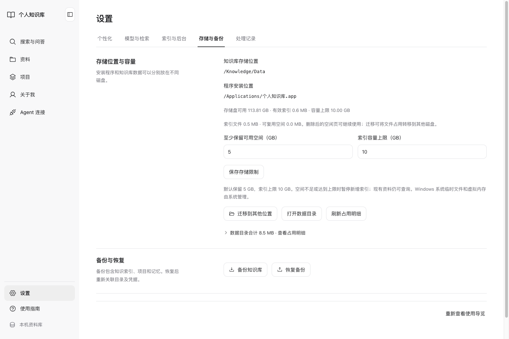
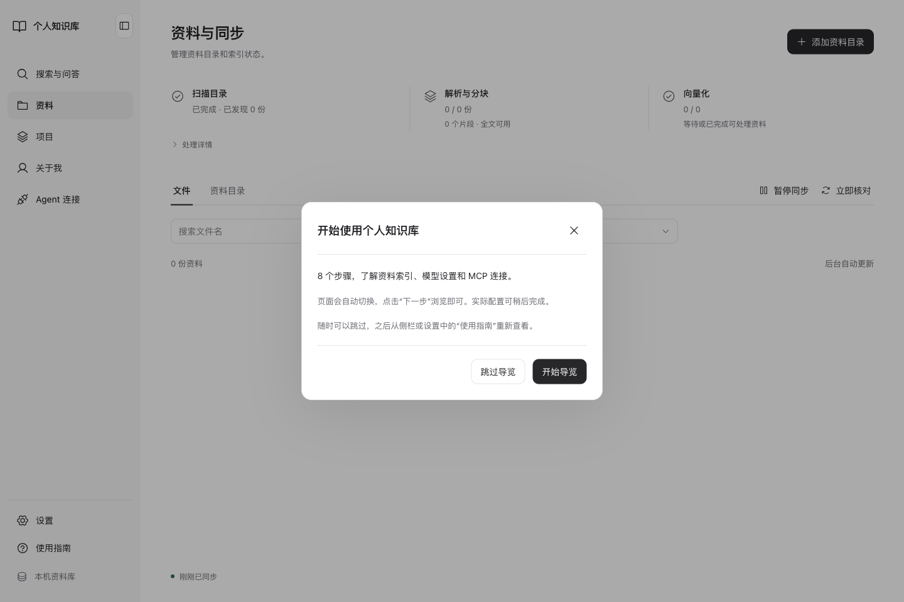
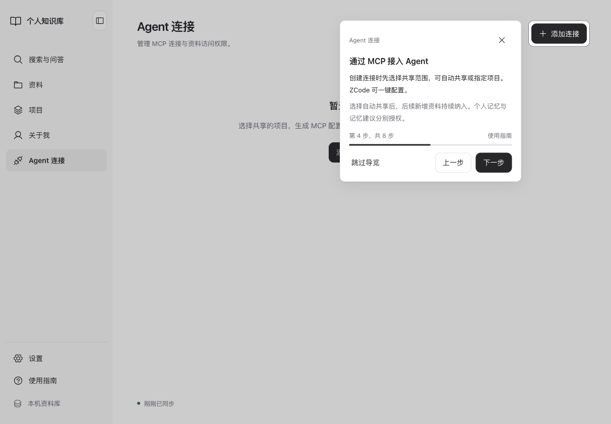
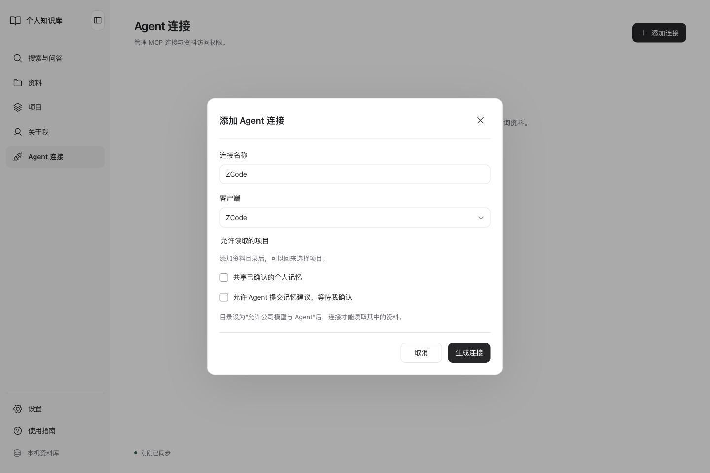
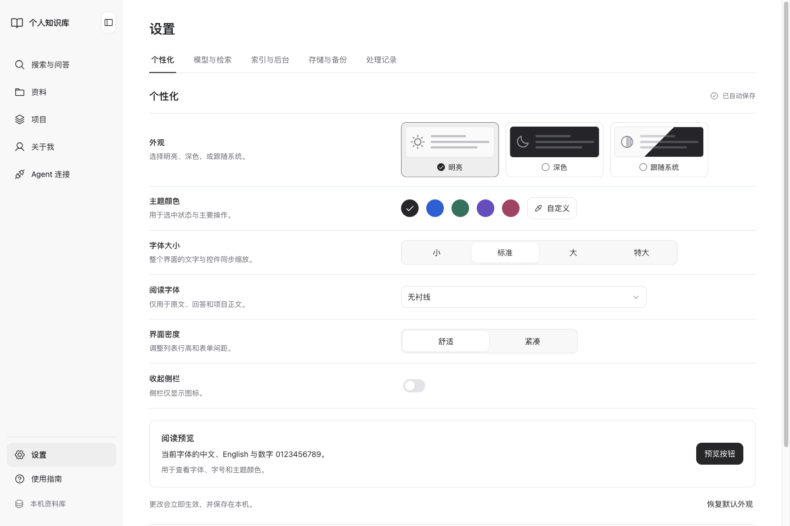

# 使用指南

[English](user-guide.md) · [简体中文](user-guide.zh-CN.md) · [项目首页](../README.zh-CN.md)

## 安装

从 [GitHub Releases](https://github.com/JshengZ/personal-ai-knowledge-base/releases/latest) 下载安装包。Source code ZIP 是开发源码，不是安装程序。

- **Intel Mac：** 打开 `.dmg`，将“个人知识库”拖入“应用程序”后启动。未签名版本如被拦截，可在系统设置 → 隐私与安全性中授权打开，不需要输入命令。
- **Windows x64：** 使用 `.exe` 安装向导选择程序目录（可放在 D 盘），按当前用户安装并生成快捷方式。目前未签名，系统可能显示未知发布者；受管理电脑按公司的软件安装流程授权。

安装包包含运行时、检索模型、字体和中英文 OCR 数据，无需注册项目账号。v1.0.1 暂不提供 Apple Silicon 或 ARM Windows 原生安装包。

## 数据位置与升级

程序目录和知识库数据目录独立。首次启动选择索引、向量、解析临时文件、浏览器缓存、日志和备份的位置；应用会在选定位置创建 `Personal-Knowledge` 子目录并显示完整路径。

已有知识库可在“设置 → 存储与备份 → 迁移到其他位置”搬迁。应用暂停同步、关闭服务，使用 SQLite 备份接口复制并校验，重启新服务后才清理旧索引和缓存。原始资料留在原处，未知文件不会删除。Agent 令牌与系统凭据命名空间保留；旧 `--home` 配置通过小型指向文件找到新位置。若程序安装路径也改变，应重新生成客户端配置。迁移后保持暂停，确认资料范围再继续。

迁移期间退出会提示等待，完成后自动重启。若因断电或强制结束中断，请重新打开设置并选择相同目标重试；应用会核对迁移记录和源版本，复用已验证的完整副本。源数据已改变或副本归属无法确认时，文件会保留并提示处理，不会覆盖现有目录。

原来的用户应用目录仍保留小型位置配置和实例锁。Windows 安装临时文件、虚拟内存由系统管理，选择 D 盘不代表 C 盘零占用。数据盘失联时会提示错误，不会在 C 盘新建一个空知识库作为替代。

默认至少保留 **5 GB** 可用空间，有效索引及数据库日志的容量上限 **10 GB**。已删除数据留下的 SQLite 空闲页可复用，不重复占用容量额度。设置同时显示有效索引、索引文件的实际大小和可复用空间。删除、排除或移除目录后，索引按小批次后台清理，原始文件保留；已确认的清理在暂停新增同步时仍继续。数据库文件通常不会随删除立即缩小，实际磁盘剩余空间仍受保护；需要释放原磁盘占用时可迁移。旧库不会因超过上限而被删除。

从 v1.0.0 升级时，先从托盘退出旧应用，再安装 v1.0.1。面对大型目录，建议先使用“仅全文”核对资料范围。已手动建立的 junction 可以保留，引擎会解析真实位置。不要直接删除 SQLite 的 WAL/SHM 文件来清理磁盘。

## 首次使用与内置导览

首次启动提供可选的 8 步导览，自动切换到实际页面并标记对应控件，涵盖资料、索引进度、检索模型、MCP 连接、搜索、项目、个人记忆和存储。点击“下一步”浏览，“上一步”返回；全程可用“跳过导览”、右上角关闭或 Escape 退出。实际添加文件与配置模型可稍后进行。

完成或跳过后保存到当前知识库，再次启动不重复弹出。侧栏“使用指南”或设置底部“重新查看使用导览”可以重放；退出后返回原页面、设置分类和滚动位置，未保存的表单草稿保留。记录保存失败会提示重试，同时允许继续使用程序。

导览仅切换界面和保存指引状态。新安装的知识库为空，程序没有示例资料入口或自动生成示例的能力。

## 添加资料

在资料页点击“添加资料目录”，使用“选择目录”选择项目或文档文件夹，再点击“加入知识库”。只监听主动添加的目录及子目录，不会扫描整台电脑。首次添加默认允许公司模型和 Agent 使用，可在“资料 → 资料目录”修改。

支持多个目录及 Git、常见包/构建入口文件的项目识别。Git 仓库中的子包保持在仓库边界内，其他顶层子目录可作为独立资料集合。新加入或主动重新索引的文件使用这些规则，升级不会自动重算全部旧片段。出现新项目后，请检查 Agent 的共享范围。Git 内部目录、依赖目录、构建产物和常见凭据文件默认排除，也可添加 glob 规则。重叠目录通过已有根目录管理。

应用从空资料库开始，添加自己的资料目录即可；不再生成示例文件。

## 配置模型

在“设置 → 公司模型”填写 API 地址、实际部署的模型名、协议和所需的 API Key，保存并测试。支持 OpenAI 兼容 Chat Completions 与 Anthropic Messages，特殊接口可展开自定义路径。

“语义检索”有三种模式：

- **自动：** 配置了公司 Embedding 接口时使用该接口，否则使用随包 Qwen 模型。
- **本地：** 固定使用 Qwen3-Embedding-0.6B。
- **仅全文：** 不使用向量检索。

对话模型地址不一定支持 Embedding；公司没有向量接口时可留空。精排有独立的接口和模型设置。Key 存入系统凭据库，不会进入备份或共享安装包。

主要通过 Agent 使用时，可以稍后配置知识库的对话模型，让 Agent 原有模型根据 MCP 资料作答。

## 处理进度与资源

“资料与同步”分开显示文件处理、文本分块和当前模型的向量数量。总片段为全库统计，实际处理范围受启用目录与权限控制。积累足够样本后显示速度和预计耗时；估算不等于性能保证。全文检索不需要等待向量全部完成。

自动模式保留随包 CPU 模型：未配置 Embedding API 时，默认超过 **50,000 个片段**，或实测速度低且预计超过两小时，会暂缓后台本地向量计算，全文继续可用。可配置部门 Embedding API、明确选择“本地”继续用 CPU，或选择“仅全文”。已有向量保留，本地预算不限制部门 API。API 默认每批 32 个片段，可调整至最多 128。

“索引资源占用”提供低占用（1 个模型线程）、均衡（最多 2 个）、优先速度（最多 6 个并留出 CPU 余量）。Windows 解析器和模型以低于正常的优先级运行。解析器 V8 堆上限为 512 MiB，这不是整个应用的总内存上限。文本按字符控制重叠；短 Word 段落合并，并保留段落范围引用。

随包 CPU 模型按单个片段提交，避免一批慢请求使已计算结果反复丢失；较慢 CPU 的单片段后台请求最多允许五分钟。暂停同步或更换检索模式会取消当前后台计算，MCP 查询仍按较短时限回退全文。部门 API 继续使用原有接口超时和设置中的批量大小。

## 接入 Agent

1. 打开“Agent 连接 → 添加连接”。
2. 选择客户端、共享项目，以及是否允许读取已确认记忆、提交记忆建议。
3. ZCode 点击“一键配置 ZCode”；应用保留并备份原配置。非默认安装可复制通用配置到客户端设置。
4. 其他客户端可复制 JSON、Codex TOML 或本机 HTTP 配置，粘贴到 MCP 设置页面。
5. 在客户端新建会话，询问“我的推荐排序项目用了什么算法？请调用知识工具并引用原文”，检查实际工具调用。

“测试共享范围”检查知识服务与授权范围；客户端是否实际调用仍需在客户端会话中验证。“接入配置”提供可复制的使用规则。

针对具体代码工程，应先 `list_projects` 确定 `project_id`，再调用 `get_context` / `search`，并读取返回的原文。列表逐文件展示不代表项目、目录信息被丢弃；跨项目结果应分别标注来源。

工具包括 `get_context`、`search`、`read_source`、`list_projects` 和 `propose_memory`。记忆建议始终先进入待确认区。

## 项目、问答和记忆

- **项目：** 维护目标、方案、决定；连接对话模型后按资料生成带依据的摘要。
- **搜索与问答：** 按项目、文件类型筛选，点击结果或引用查看页码、代码行、段落、幻灯片和单元格。
- **关于我：** 确认、修正、忽略或删除记忆。原文变化后，依赖它的已确认记忆会转为“待复核”。

岗位与经验推断属于有依据的建议，不会训练模型，也不等于已核验的岗位身份。

## 同步与备份

新增、修改、重命名和删除文件会自动处理；应用启动和周期核对可补偿休眠期间遗漏的事件。可使用“立即核对”“暂停同步”“继续同步”，索引错误及重试入口位于资料列表。

关闭窗口后仍在托盘运行；从托盘或菜单退出才停止服务。可在设置中开启登录后启动。stdio MCP 客户端也可按需启动后台服务。

在设置中导出 `.pkb` 或选择备份恢复。原文件、API Key、Agent 令牌不会迁移。恢复会先验证数据库结构及记录内容，将允许的数据导入新库，验证通过后再替换当前库。恢复前生成恢复点；恢复后暂停同步、禁用目录，需重新关联目录、填写凭据并创建连接。

## 常见情况

| 现象             | 处理方式                                             |
| ---------------- | ---------------------------------------------------- |
| 有资料但没有回答 | 配置对话模型，或在 MCP Agent 中使用检索结果回答。    |
| 只有全文检索     | 检查检索模式和连接测试；语义索引可能仍在建立。       |
| Agent 看不到资料 | 检查目录权限、项目范围、连接状态和索引进度。         |
| 原文暂不可读     | 等待索引完成或重新连接原磁盘；不会直接返回过期资料。 |
| 文档解析失败     | 查看资料页原因，先解密文档、转换旧版 Office 格式。   |
| 模型连接失败     | 检查网络、协议、模型名、路径、凭据和企业 CA 信任。   |

解析器文件上限 32 MB，纯文本/代码输入上限 8 MB、10 万行，单份提取内容最多 4 Mi UTF-16 单元及 5,000 片段，超出需拆分。PPTX 提取正文、标准表格文字和备注，不完整识别嵌入图片、SmartArt 与独立图表数据；扫描 PDF/图片可本地 OCR，Office 内嵌图片不自动 OCR。`.ppt`、`.doc`、`.xls` 需转换。常见不支持格式和未提取到文字会单独显示。

单文件上限最多 32 MB；备份上传限制 512 MB，恢复数据库限制 1 GiB。超大 OCR 页面受资源限制，尚未接入音视频和在线企业文档。已验证范围见[验收记录](verification.zh-CN.md)。

## 外观与个性化

打开 **设置 → 个性化**。默认明亮，可切换深色或跟随系统；主题色支持预设和自定义，字号支持小／标准／大／特大（13／14／16／18 px），阅读字体支持无衬线和衬线，另有舒适／紧凑密度和侧栏收起开关。更改即时预览并自动保存在本机；保存失败会提示重试。**恢复默认外观**会重置所有外观选项，模型、资料目录和 Agent 权限保持原设置。偏好随知识库备份和存储迁移保留。

设置按个性化、模型与检索、索引与后台、存储与备份、处理记录分组。切换分组保留尚未保存的模型字段；模型、索引和存储限制仍需点击各自的保存按钮。外观独立自动保存。窄窗口会将侧栏收为图标，可悬停查看名称，或扩大窗口显示完整文字。

