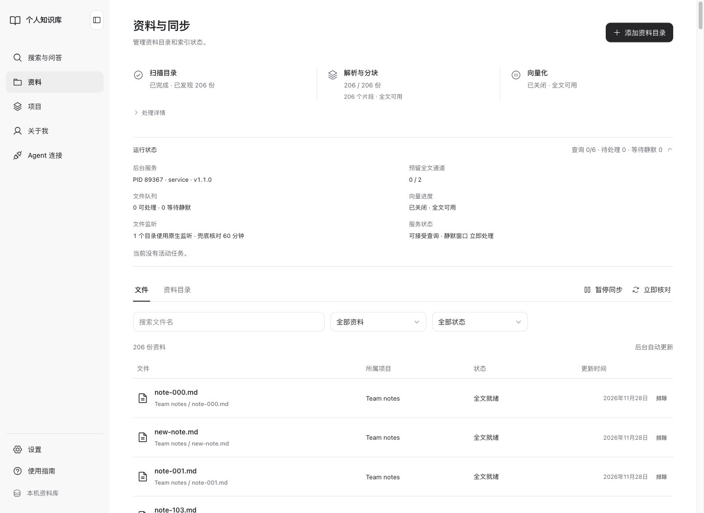
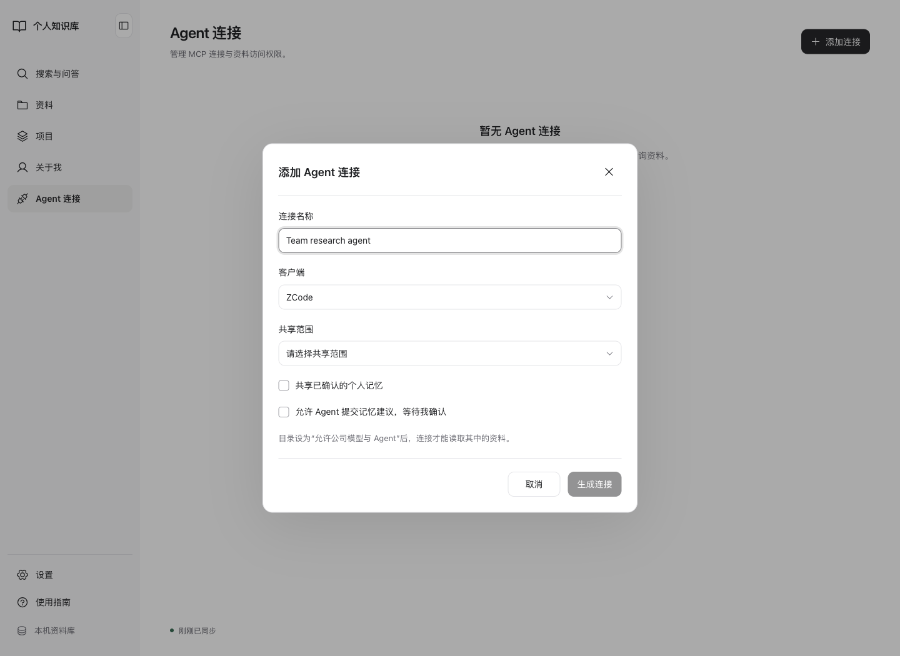

# Verification record

[English](verification.md) · [简体中文](verification.zh-CN.md) · [Home](../README.md)

Initial verification: **1.0.0, 2026-11-25**. Current verification: **1.1.0, 2026-11-28**; previous release evidence is retained below. Local build host: Intel macOS 14.6.1. Targets: Intel Mac and Windows x64. All fixtures are synthetic and isolated from real personal work folders.

## 1.1.0 verification (2026-11-28)

All fixtures are synthetic and isolated. Local evidence comes from Intel Mac/macOS 14.6.1, not a rerun of the company's complete 34 GB Windows source set.

- 54 Rust regressions passed: 23,000 synthetic metadata rows with complete totals/stable pagination, reserved UI reads during mutation saturation, WAL/FTS reads during writer/normal-query contention, quiet generations, duplicate-chunk recovery and restore invalidation.
- Real cold/concurrent MCP clients and all five tools/protocol versions passed. Contended 14–18 second proposals returned committed records; identical retries reused IDs. Native events handled changes/renames/deletions. Organization-compatible API and full-text integration regressions passed.
- An independent read-only subagent reproduced and accepted: 3500 repeated chunks restored after partial cleanup; three restores with ten reads each agreeing with disk; reserved FTS in 275 ms while six normal queries were occupied; cancellation freeing capacity in about 2.92 s; stalled-body shutdown in 1.36 s; five quick exits without panic. These are fixture measurements, not general performance guarantees.
- A desktop flow with 206 actual temporary files covered full pagination, expansion surviving refresh, preserving/retrying a failed IPC read, explicit sharing, direct routing, quiet time and wide/narrow status layouts. Screenshots contain no real personal/company data.
- Release gates run native macOS/Windows source regressions and packaged model/OCR/MCP/UI checks. Windows additionally checks engine PE product/file versions. Package audits and publication verify exact source provenance, resource hashes and exclusion of knowledge/credentials before release.

Independent pressure testing also covered 628 reads on four lanes and 600 policy/name changes during indexing/exclusion/cleanup without a missing collection. A deterministic regression first reproduced the counter early-return snapshot leak, then verified RAII and return-to-pool rollback. SQLite was separately updated to include the upstream WAL-reset fix.

## 1.0.2 verification (2026-11-27)

This update adds named collection ownership, batch selection, dynamic sharing and consistent exclusion rules. Schema 1→2 migration updates metadata while preserving chunks, vectors and client tokens. Existing selected connections do not widen automatically.

- 44 local engine cases passed. Ten new cases cover directly selected Nuitka roots, combined markers, binary/category checks, rule precedence, archival/re-addition, legacy scope migration, old-vector reclamation, final commit validation, immediate hit names and ancestor links. Backup restore advances the library revision to invalidate open results.
- 23 parser/release/real-service/MCP-resilience cases passed; one Windows-specific process case is skipped on Mac and must run in native Windows CI.
- Native Playwright Electron acceptance exercises multi-folder IPC/multiselect options, independent names, collection/project selectors, pre-existing automatic connections receiving later projects, policy revocation, paused cleanup, inclusion restoration, partial success, archival and original preservation. The native dialog is tested through options and returned selections, not manual interaction with every OS picker.
- An independent agent reproduced and rechecked in-flight deletion, stale hit names, ancestor links and edits during batch submission using separate isolated scripts. A 14 MB in-flight fixture remained archived after removal with zero old documents/chunks. UI checks include 1200×820 and 640×520, failed-row retry and saved automatic/selected modes, without related page errors.

Both platform source CI and packaged acceptance include existing storage/appearance/guide regressions and the new collection flow. Exact native results and sources are identified by the [v1.0.2 release](https://github.com/JshengZ/personal-ai-knowledge-base/releases/tag/v1.0.2) `BUILD-INFO.json` and linked Actions. Publication requires successful source CI, secret scan and both native packaged jobs.

[Batch folders](images/collections-batch.png) · [Collection scopes](images/collections-scopes.png) · [Automatic sharing](images/collections-sharing.png). Screenshots contain synthetic acceptance inputs only; installers start empty.

## Published 1.0.1 evidence

[v1.0.1](https://github.com/JshengZ/personal-ai-knowledge-base/releases/tag/v1.0.1) uses application source [`8e53519888a8`](https://github.com/JshengZ/personal-ai-knowledge-base/commit/8e53519888a8c505b1d1c4a64df46b4fe3cf75c4). Both native platforms passed [source CI](https://github.com/JshengZ/personal-ai-knowledge-base/actions/runs/45837018805) and [packaged-app checks](https://github.com/JshengZ/personal-ai-knowledge-base/actions/runs/45837019823). The [publication run](https://github.com/JshengZ/personal-ai-knowledge-base/actions/runs/45841474706) verifies source, versions, sizes and installer digests before publication. The release's `BUILD-INFO.json` separately identifies the publishing-tool commit.

Windows verified all five fixture documents, six real local vectors, two projects, PDF/OCR/XLSX, hybrid MCP retrieval and memory review, then all three packaged appearance/migration/guide cases with no related console errors. Its standalone 2,392-character embedding took about 158 seconds on the baseline CI CPU; this is a fixture measurement, not a performance guarantee. Mac passed the same package checks. Both package audits report no bundled personal data or credentials. Installers remain unsigned; company API and actual ZCode acceptance remain environment-specific.

## 1.0.1 local regression results (2026-11-26)

Added cases exercise stdio initialize/tool discovery with an unresponsive backend; HTTP/stdio and full-text fallback with one async worker and deliberately slow embeddings; HTTP handshakes while the database writer is held; old MCP configurations after migration; cancellation of long parsing; and Windows worker cleanup after forced termination. Desktop GUI tests cover limits, migration/restart, removal of the old database, preservation of originals and resumed filesystem watching, with wide/narrow screenshots.

Additional cases cover local auto budgets, continued department-API/explicit-CPU support, capacity thresholds, incremental counters, long-line overlap, paragraph grouping and project detection. The packaged local-model flow includes longer Chinese chunks. Consult Actions and the execution record for the exact source commit. Synthetic tests are not a million-vector performance benchmark; no private organization corpus is uploaded for validation.

### Completed locally for 1.0.1

| Check                      | Result                                                                                                                                                                                                                                                                                                                                                                            |
| -------------------------- | --------------------------------------------------------------------------------------------------------------------------------------------------------------------------------------------------------------------------------------------------------------------------------------------------------------------------------------------------------------------------------- |
| TypeScript / Rust          | Type checks and production builds pass; unused frontend declarations checked.                                                                                                                                                                                                                                                                                                     |
| Engine                     | 34 cases pass, including rejected backups preserving the live library, canonical restores, quota/reusable pages, durable bounded cleanup, immediate exclusions, warmed-process reuse after query cancellation, endpoint identity and migration recovery.                                                                                                                          |
| Parsers                    | 14 cases pass, including local OCR, short-paragraph grouping and bounded long-line overlap.                                                                                                                                                                                                                                                                                       |
| Integration                | Real watching, compatible model APIs, standard SDK stdio/HTTP MCP, scopes, memory review and backup/restore pass. The sample generator is removed.                                                                                                                                                                                                                                |
| Resilience                 | 4 cases pass on Mac: hung-backend stdio handshake, slow embeddings/FTS/migration, parser cancellation, and a summary taking over twelve seconds returning its committed result. The forced-termination Job Object case is skipped on Mac.                                                                                                                                         |
| Built-in guide             | Native Electron verifies an empty library, persistent skip/completion, no repeated introduction after restart, eight real targets, replay, retained drafts and save retry. Chrome covers 1212/640/390/320 px, light/dark and 14/18 px text, with no business writes or related console errors. Independent review closed three P2 findings, including 600 concurrent-save trials. |
| Appearance and storage GUI | Native Electron verifies all appearance options, mouse/keyboard pickers, isolated provider/key drafts, quit-during-migration protection, actual migration/restart and continued source watching.                                                                                                                                                                                  |
| Design / accessibility     | All main pages and settings groups checked at 1536/1024/800/390 px, including 18 px base text, dialogs, active navigation and visible save-failure/retry recovery. No related console/page errors. See [design QA](../design-qa.md).                                                                                                                                              |
| Full Mac package           | Rebuilt post-review package passes five synthetic documents, two projects, six local vectors, PDF/OCR/XLSX, citations, MCP and memory review. A separate packaged-app run verifies controls, appearance, migration/restart and watching. No external model is used.                                                                                                               |
| Windows package            | Post-review x64 cross-build, assisted NSIS package and content audit complete. Both platform audits contain target resources and the pinned model, with no personal database or bundled credentials. Native package checks are recorded in the installer workflow; company-workstation acceptance remains separate.                                                               |

The [source CI matrix](https://github.com/JshengZ/personal-ai-knowledge-base/actions/workflows/ci.yml) tests native Windows and macOS, including guide replay and desktop migration. The [installer workflow](https://github.com/JshengZ/personal-ai-knowledge-base/actions/workflows/build-installers.yml) also tests the packaged apps. Use the exact successful run and source commit recorded with the release; a configured job alone is not a passing result. Package and source checks are separate from acceptance on a company workstation. No real company API credentials or documents are used.

The Windows packaged smoke test allows up to six minutes for its CPU embedding fixture and logs progress every fifteen seconds, with source-status and service-log diagnostics on failure. It still requires complete vector coverage and actual hybrid MCP retrieval; a timeout does not count as a pass. A baseline Windows CPU took about 113 seconds for a 1,955-character fixture, exposing the former 120-second timeout on longer chunks. Background local calls now allow five minutes per chunk and observe pause, provider/profile changes and shutdown. Department API and interactive retrieval deadlines remain separate.

## Historical 1.0.0 checks

| Check                 | Evidence                                                                                                                                                                                                                  |
| --------------------- | ------------------------------------------------------------------------------------------------------------------------------------------------------------------------------------------------------------------------- |
| Static/build checks   | TypeScript check, Rust check, frontend build, desktop build, and both target engine builds passed.                                                                                                                        |
| Engine unit tests     | 7 passing cases covering stale reads, deletion/invalidation, live revocation, local-only project isolation, model/dimension separation, backup handling, and preserving ZCode settings.                                   |
| Parser tests          | 10 passing cases: code locations, DOCX, safe XML character decoding, PPTX order/notes, XLSX cached formulas/cells, multiline CSV, PDF pages, notebooks, persistent worker recovery, and actual scanned-PDF OCR.           |
| Integration           | Real file creation/modification/rename/deletion, compatible model API protocols, official SDK stdio/HTTP MCP, permission changes, memory review/staleness, backup/restore, canonical sample paths.                        |
| Real local retrieval  | Bundled Qwen3-Embedding-0.6B, 1024 dimensions, real vector indexing and hybrid retrieval without an external model API.                                                                                                   |
| Packaged Mac workflow | Native folder wizard, two projects, five real fixtures, PDF/PNG OCR/XLSX/text, local embeddings, workspace filtering, actual MCP client calls, memory proposals/confirmation/deletion, and asynchronous backend exit.     |
| UI                    | Project editing, source reading, search, synchronization, memories, connections, and model settings; 1488/1024/390 px layout checks; zero relevant console errors after fixing favicon. See [design QA](../design-qa.md). |
| Windows binaries      | Engine cross-built for x64 GNU; llama.cpp statically built from pinned source; imports do not require VCRUNTIME/MSVCP or MinGW dynamic runtimes.                                                                          |
| Package audits        | Only target platform engines/native modules; pinned model digest; no knowledge database, backup, owner token, agent token, or API key; blank generic organization template.                                               |

The initial 1.0.0 verification covered 19 local automated test cases/workflows across the engine, parser, integration, and packaged smoke suites. Hosted CI results are independently visible in [Actions](https://github.com/JshengZ/personal-ai-knowledge-base/actions); adding a workflow alone is not a passing run.

Provider integration uses a synthetic local OpenAI-compatible API, not a real organization's model deployment. ZCode config tests use temporary paths and do not prove behavior in an actual installed ZCode client. Native API-key storage with organization credentials is not claimed as verified here.

## Pending environment acceptance

1. Install and exercise the Windows GUI, tray, startup, directory picker, watchers, PDF/OCR, and local retrieval on a target Windows workstation. ARM Windows is not included.
2. Test the real organization API URL, deployed models, credentials, custom paths, network, and enterprise certificate trust in the app.
3. Run an actual ZCode session after configuration and check `get_context/search/read_source` calls and citations for that client version.
4. Configure a real signing identity and, for macOS, notarization before making claims about signed distribution. The initial installers are unsigned.

Windows CI backend tests, when successful, are useful additional evidence but do not replace target-workstation or real-client acceptance.

## Current boundaries

- Explicitly selected local folders only; no full-disk crawl, online document connectors, audio/video transcription, or model training.
- Inferred experience/roles are reviewable suggestions. An agent is not guaranteed to call MCP for every message.
- Exact cosine search is used for personal collections; small-fixture timing is not a large-scale benchmark.
- Maximum file setting: 32 MB; backup upload: 512 MB; restored database: 1 GiB. Large OCR pages have resource limits.
- No automatic online updates. Quit the old tray application before replacing it; per-user knowledge remains in its data directory.

Maintainers can run `node --test tests/packaged.test.mjs`; `PKB_PACKAGED_APP` selects a particular executable. Package audits use `node scripts/verify-package.mjs mac` or `win`. Shutdown checks allow the background process to finish asynchronous cleanup.

Release assets include `SHA256SUMS.txt` and `BUILD-INFO.json`. Publishing source and generic installers does not publish a user's database, work files, credentials, or backups.
