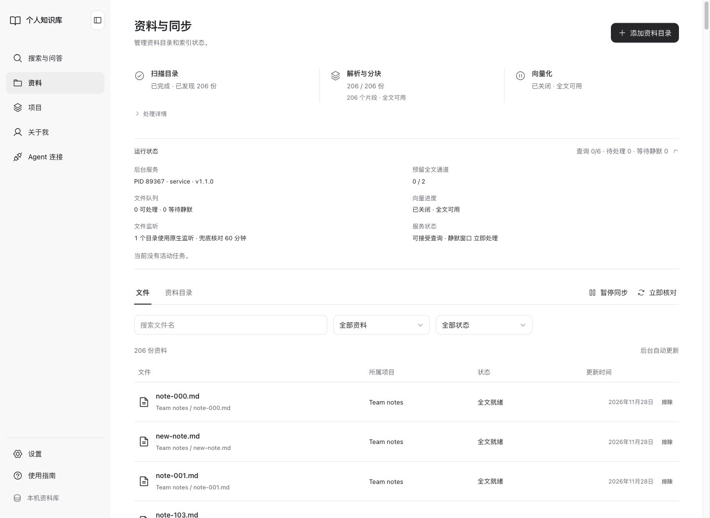
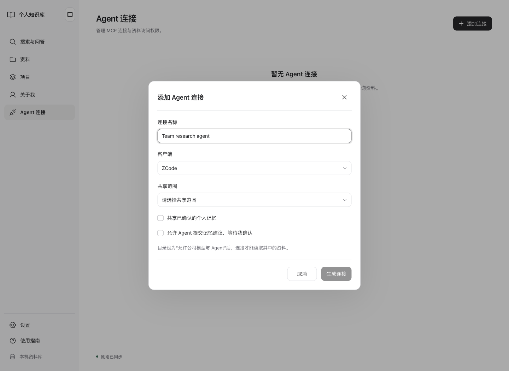

[English](verification.md) · [简体中文](verification.zh-CN.md)

# 交付验证记录

初次验收：1.0.0，2026-11-25；本轮验收：1.1.0，2026-11-28；下方保留此前公开版本的证据。本地构建机器为 Intel Mac，macOS 14.6.1，目标 Mac x64、Windows x64。测试仅使用独立生成的合成资料，没有扫描或上传真实个人工作目录。

## 1.1.0 验证（2026-11-28）

验证仅使用临时合成库；本机为 Intel Mac／macOS 14.6.1。下列本地记录不等于公司 Windows 34 GB 资料已经重验。

- Rust 51 项回归通过，含 2.3 万条合成元数据的完整总数和稳定分页、占满修改通道时的 UI 读取、持有写锁／普通查询饱和时预留 FTS、静默代际、重复片段恢复和在线恢复读池失效。
- 真实 MCP 冷启动／3 并发客户端／所有五个工具与协议版本通过；14–18 秒争用下记忆建议返回成功，相同输入重试返回同一记录。仅原生事件完成修改、重命名和删除，全文与公司兼容 API 集成回归通过。
- 独立只读子智能体复现并验收：3500 重复片段在部分回收后完整恢复；3 轮在线恢复每轮 10 次读取与磁盘一致；6 普通查询占满时预留 FTS 275 ms 返回，取消后约 2.92 秒释放；上游正文停滞时退出 1.36 秒；5 次快速退出无 panic。指标为本机合成测试测量，非通用性能承诺。
- 206 份真实临时文件的桌面测试验证多页完整加载、后台刷新保持数量、一次 IPC 超时后保留并重试、明确共享选择、直连设置、静默时间和宽／窄状态面板。截图不含真实个人目录或公司内容。
- 发布门禁在 macOS 与 Windows 原生环境运行源代码回归和打包后模型／OCR／MCP／界面验收；Windows 包额外检查引擎 PE 文件及产品版本。安装包审计与发布流程验证源码提交、资源摘要及无资料／凭据；通过后才可发布。

## 1.0.2 验收（2026-11-27）

本轮增加集合归属／命名、批量选择、动态共享与统一排除。升级仅迁移元数据，数据库版本从 1 升到 2；旧片段、向量和连接令牌保持。已有指定范围连接不自动扩权。

- 本地引擎 44 项通过；新增 10 项覆盖 Nuitka 直接根目录、标记识别、类别／二进制、规则优先级、归档与重新添加、旧模式迁移、旧向量清理、最终提交复核、名称即时一致性和上层目录链接。备份恢复会推进资料修订号，使当前结果失效。
- 解析／发布／真实服务集成／MCP 韧性共 23 项通过，1 项 Windows 专用进程测试在 Mac 跳过；原生 Windows CI 必须实际执行。
- Playwright 原生 Electron 完整流程通过：多目录 IPC、多选属性、独立名称、整集合／子项目范围、预先建立的连接自动纳入新项目、目录撤权、暂停清理、重新纳入、部分成功、删除归档和原文件保留。原生系统对话框通过传入多选属性和测试返回路径验证，不等于人工检查每种系统文件选择器。
- 独立子智能体使用自己的隔离脚本复现并复验：删除期间解析写回、搜索名称、上层链接和提交中编辑。14 MB 合成文件在途删除后，归档仍保留且旧文档／片段均为 0。界面覆盖 1200×820、640×520、部分失败重试与自动／指定范围回显；无相关页面错误。

新旧桌面存储、个性化、导览和集合流程同时纳入双平台源码 CI 与打包版验收。具体提交及原生结果以 [v1.0.2](https://github.com/JshengZ/personal-ai-knowledge-base/releases/tag/v1.0.2) 附件 `BUILD-INFO.json` 和关联 Actions 为准；发布流程要求两端源码检查、敏感信息扫描和两端打包检查均成功。

[批量目录](images/collections-batch.png) · [集合范围](images/collections-scopes.png) · [自动共享](images/collections-sharing.png)。截图仅含合成验收资料，安装后没有这些资料。

## 1.0.1 正式发布证据

[v1.0.1](https://github.com/JshengZ/personal-ai-knowledge-base/releases/tag/v1.0.1) 的应用源码为 [`8e53519888a8`](https://github.com/JshengZ/personal-ai-knowledge-base/commit/8e53519888a8c505b1d1c4a64df46b4fe3cf75c4)。Mac 和 Windows 均通过[源码 CI](https://github.com/JshengZ/personal-ai-knowledge-base/actions/runs/45837018805)及[打包版检查](https://github.com/JshengZ/personal-ai-knowledge-base/actions/runs/45837019823)。[发布记录](https://github.com/JshengZ/personal-ai-knowledge-base/actions/runs/45841474706)在公开前核对源码、版本、大小和安装包摘要；附件 `BUILD-INFO.json` 另外记录发布工具的提交。

Windows 实测完成五份资料、六个真实本地向量、两个项目、PDF/OCR/XLSX、MCP 混合检索和记忆审核，随后三项打包版外观／迁移／导览测试全部通过，无相关控制台错误。基础 CI CPU 对 2,392 字输入的独立向量计算约 158 秒，仅代表该合成用例，不是性能保证。Mac 通过相同的打包版检查。两端包审计均未发现随包个人数据或凭据。安装包未签名，真实公司 API 和实际 ZCode 客户端仍需在目标环境验收。

## 1.0.1 本地回归结果（2026-11-26）

在原有验收基础上，新增：后端不响应时的 stdio 初始化/工具发现、单异步线程与慢 Embedding 下的 HTTP/stdio 握手及全文降级、持有数据库写锁时的握手、迁移后沿用旧 MCP 配置、取消长解析及 Windows 强杀后的子进程清理。桌面 GUI 测试覆盖存储限制、迁移重启、旧数据库清理、原文保留及新文件继续同步，并记录宽/窄视口截图。

另有本地自动预算、部门 API 与显式 CPU 模式保留、磁盘阈值、增量计数、长行重叠、Word 段落合并和工程识别用例。完整本地模型打包测试包含较长中文片段。以当前提交的 Actions 与实际执行记录为准；这些合成数据测试不代表数百万向量的性能基准，也未上传真实公司资料进行测试。

### 1.0.1 已完成的本地检查

| 检查              | 结果                                                                                                                                                                                                                                            |
| ----------------- | ----------------------------------------------------------------------------------------------------------------------------------------------------------------------------------------------------------------------------------------------- |
| TypeScript / Rust | 类型检查及生产构建通过，另检查前端未使用声明。                                                                                                                                                                                                  |
| 引擎              | 34 项通过，含无效备份保留当前库、标准结构恢复、容量及持久化分批清理、排除即时撤权、取消查询后复用已预热模型、接口标识和迁移中断恢复。                                                                                                           |
| 解析              | 14 项通过，覆盖本地 OCR、短段落合并和长行受限重叠。                                                                                                                                                                                             |
| 集成              | 真实文件监听、兼容模型 API、标准 SDK stdio/HTTP MCP、权限、记忆、备份恢复通过；示例生成能力已移除。                                                                                                                                             |
| 韧性              | Mac 通过 4 项：后端挂起时 stdio 握手、慢向量任务下响应/全文降级/迁移、解析取消，以及超过 12 秒的摘要正确返回已提交结果。Windows 强杀 Job Object 用例在本轮 Mac 中跳过。                                                                         |
| 内置导览          | 原生 Electron 验证空库、跳过／完成持久化、重新启动不重复、8 步真实控件、重放、草稿保留和失败重试。Chrome 另检查 1212／640／390／320 px、明暗主题及 14／18 px 字号；无业务写入或相关控制台错误；独立审查的 3 项 P2 已关闭，并发保存 600 轮通过。 |
| 个性化与存储 GUI  | 原生 Electron 实测所有外观选项、鼠标及键盘选单、模型与 Key 草稿隔离、迁移途中正常退出保护、实际迁移重启及后续监听通过。                                                                                                                         |
| 设计与可用性      | 1536/1024/800/390 px 下检查全部主要页面和设置分组，含 18 px 特大字号、弹窗、导航和保存失败重试；无相关页面或控制台错误。见[界面验收](../design-qa.md)。                                                                                         |
| Mac 完整安装包    | 本轮重新构建后，完整包通过两项目、五文档、六个本地向量及 PDF/OCR/XLSX、引用、MCP 和记忆确认；另通过打包应用的控件、外观、迁移重启回归。未使用外部模型。                                                                                         |
| Windows 安装包    | 本轮 x64 引擎交叉构建及带目录选择的 NSIS 包完成，包内检查通过。两平台仅含对应资源，模型摘要正确，不含个人数据或凭据；原生包测试记录见安装包工作流，公司电脑验收单独进行。                                                                       |

[源码 CI](https://github.com/JshengZ/personal-ai-knowledge-base/actions/workflows/ci.yml) 在 Windows 与 macOS 原生运行，包含导览重放和桌面迁移；[安装包工作流](https://github.com/JshengZ/personal-ai-knowledge-base/actions/workflows/build-installers.yml) 另测试打包后的程序。请核对发布版本记录的具体源码提交及成功运行，配置了工作流不等于测试通过。源码、安装包与公司电脑验收分别记录；测试不使用真实公司资料或凭据。

Windows 打包测试为 CPU 向量计算提供最多六分钟的等待窗口，每十五秒记录进度，失败时输出资料状态和服务日志。通过条件仍要求全部向量完成及真实 MCP 混合检索成功，超时不视为通过。实测基础 Windows CPU 处理 1,955 字约需 113 秒，暴露出较长片段超过原有 120 秒超时的问题。后台本地调用现允许每片段五分钟，并响应暂停、模型／资源档位变化及退出；部门 API 和交互检索保留各自时限。

## 1.0.0 历史验收

| 检查                   | 结果与证据                                                                                                                                                                         |
| ---------------------- | ---------------------------------------------------------------------------------------------------------------------------------------------------------------------------------- |
| TypeScript / Rust 检查 | `npm run check` 通过                                                                                                                                                               |
| 后端单元测试           | 7 项通过：资料变更拒绝旧文本、删除清理、来源失效、动态撤销、仅本机项目隔离、模型/维度隔离、备份与 ZCode 配置保留                                                                   |
| 文件解析               | 10 项通过：中文代码与行号、DOCX、XML 字符、PPTX 顺序/备注、Excel 公式缓存/单元格、CSV 引号换行、PDF 页码、Notebook、持久化工作进程和真实扫描 PDF OCR                               |
| 端到端集成             | 真实临时文件的新增、修改、重命名、删除；公司兼容 API 协议；标准 SDK stdio/HTTP MCP；记忆状态、动态权限与备份恢复；路径别名不产生重复示例项目                                       |
| 真实本地检索           | 随包 Qwen3-Embedding-0.6B，1024 维；样例资料完成向量化并返回 hybrid 检索；无公司或公共模型接口参与                                                                                 |
| 打包后的 Mac 应用      | 原生目录选择完成向导；两项目、五份文件；PDF、PNG OCR、XLSX 与文本解析全部通过；本地向量检索与项目切换通过；真实 MCP 客户端读取并提交记忆建议，界面确认及删除通过；退出停止后台服务 |
| 界面                   | 项目编辑、来源查看、查询、同步控制、记忆、连接与设置；1488/1024/390 px 检查；修复 favicon 404 后控制台为零错误；详见根目录 `design-qa.md`                                          |
| Windows 可执行文件     | Rust 知识服务完成 x64 GNU 交叉编译；llama.cpp 从固定源码静态构建，PE 导入表检查未依赖 VCRUNTIME/MSVCP 或 MinGW 动态库                                                              |
| 安装包                 | Mac DMG、Windows 当前用户 NSIS 安装包均已构建；包含运行时、Qwen、OCR 与许可证，最终文件见 `release/`                                                                               |
| 安装包内容审计         | 两个平台均通过：仅含目标平台服务和原生模块；模型 SHA-256 与固定版本一致；没有个人数据库、备份、管理令牌或 Agent 令牌；组织模板不含 Key                                             |

公司 API 集成使用本机模拟的 OpenAI 兼容服务验证 Embedding、Chat 和 Rerank 的完整调用流程；这不等于已连接公司的真实模型。ZCode 配置写入测试使用临时配置路径，验证保留既有服务与备份；没有修改本机真实的 ZCode 配置。

打包后完整流程可由维护人员运行 `node --test tests/packaged.test.mjs`。默认选择本机平台包，可用 `PKB_PACKAGED_APP` 指定被测可执行文件。文件与凭据检查使用 `node scripts/verify-package.mjs mac` 或 `win`。

退出应用后会等待知识服务完成异步清理；测试按最终服务退出状态验收，不假设桌面进程与后台进程在同一毫秒结束。

## 需要在公司环境完成

以下属于尚未具备的实机环境，不能以编译成功代替验收：

1. 在目标 Windows 电脑双击安装并启动，检查首次向导、托盘、自启动、原生目录选择、文件监听、PDF/OCR 与本地检索。当前提供 x64 包，ARM Windows 不在本次目标中。
2. 在界面填写真实的公司 API 地址、模型名和个人凭据，检查网络、企业 CA、协议、自定义路径及实际模型返回内容。
3. 点击“一键配置 ZCode”，重启或新建客户端会话，确认真实客户端调用 `get_context/search/read_source` 并保留来源。ZCode 具体版本的行为需要实机确认。
4. 由公司签名身份构建正式分发包，完成 macOS 公证与 Windows 签名。当前没有可用签名证书，因此安装包未签名，系统可能显示未知发布者或打开授权提示。

## 当前功能边界

- 只自动监听主动添加的本机目录；没有全盘扫描、在线企业文档连接器、音视频转录或自动训练模型。
- 角色与经历由证据和确认流程形成记忆，不保证 Agent 每次都主动调用 MCP。连接页附带客户端使用规则。
- 本地向量候选使用精确余弦检索，没有宣称百万文档性能。小样例延迟仅验证功能，不代表大规模性能基准。
- 默认单文件 32 MB；界面备份上传上限 512 MB，恢复数据库上限 1 GiB。大规模存储与流式备份可沿现有模块边界扩展。
- 当前没有自动在线更新；源码和通用安装包通过 GitHub Releases 公开。升级前从托盘退出旧版本，安装新包，知识数据按用户目录保留。

最终安装包的 SHA-256 记录在对应 `release/<platform>/SHA256SUMS.txt`，分发时只需要安装包；不要发送个人数据目录或自己的 `.pkb` 备份作为安装材料。
